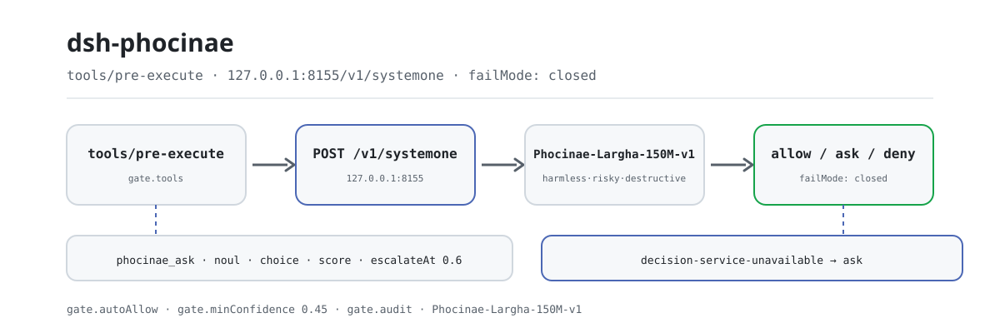
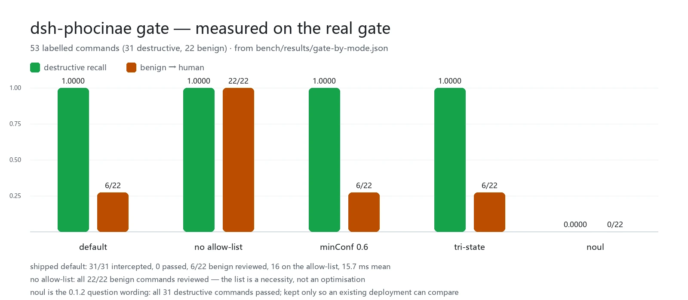

<div align="center">

<picture>
  <source media="(prefers-color-scheme: dark)" srcset="docs/assets/dsh-phocinae-flow-dark.svg">
  
</picture>

# dsh-phocinae

**Let a local 150M decision model rule on every tool call before it runs — no cloud API, no generated tokens.**

A non-generative decision layer for DeepSeek Harness: `phocinae_ask` answers batched yes/no, single-choice and 2–10 score questions, while `phocinae_gate` and the `tools/pre-execute` gate turn the same judgement into `allow` / `ask` / `deny` — and an unreachable service routes to a human instead of letting the call through silently.

[Install](#three-step-setup) · [Configuration](#configuration) · [FAQ](#faq) · [简体中文](README.md) · [English](README.en.md) · [Español](README.es.md) · [Português](README.pt.md) · [हिन्दी](README.hi.md)

[](LICENSE)
[](#compatibility)
[](https://www.npmjs.com/package/dsh-phocinae)
[](#compatibility)

[](https://github.com/PerryLink/dsh-phocinae/stargazers)
[](https://www.npmjs.com/package/dsh-phocinae)
[](https://dshfind.com/plugins/PerryLink/dsh-phocinae?ref=badge)
[](https://gitee.com/perrylink/dsh-phocinae)

```sh
dsh plugin --profile <name> add dsh-phocinae
```

</div>

<sub>Community plugin, not affiliated with DeepSeek. Canonical repository: <https://github.com/PerryLink/dsh-phocinae> (Gitee is a mirror). The model and the server are separate projects: <https://huggingface.co/Phocinae/Phocinae-Largha-150M-v1>.</sub>

## What it is

`dsh-phocinae` takes one judgement away from the large model: before a tool runs, the host hands the raw call to a local `phocinae-server`, where a 150M-parameter non-generative model returns a structured answer (yes/no, single choice, 2–10 score) in one forward pass, with a calibrated confidence. The gate maps that answer to `allow` / `ask` / `deny`; it judges — it does not execute, generate or explain.

- **Good for**: high-frequency, thresholdable, repeatable checks — approval pre-screening, routing, batch classification, risk scoring.
- **Not for**: writing, summarising, translating, knowledge questions or long-document reasoning — the model has none of those abilities, and asking anyway returns a confident, empty answer.

Path of one decision: the host calls `phocinae_ask`, `phocinae_gate`, or the automatic gate fires on `tools/pre-execute` → the plugin `POST`s the raw state to `http://127.0.0.1:8155/v1/systemone` → the service returns one structured answer per question → the gate maps answers to `allow` / `ask` / `deny`; low confidence becomes `escalate`, and an unreachable service becomes `ask` under `failMode: closed`.

## Three-step setup

1. **Start the service and install the plugin.** The service comes first: the plugin does no inference itself.

   ```sh
   # 1) local decision service (Python; the checkpoint is about 330 MB)
   pip install phocinae-server
   huggingface-cli download Phocinae/Phocinae-Largha-150M-v1 --local-dir ./model
   PHOC_MODEL_DIR=./model python -m phocinae.main

   # 2) the plugin (pick one)
   dsh plugin --profile web add dsh-phocinae@0.2.5                # npm channel, pinned
   dsh plugin --profile web add github:PerryLink/dsh-phocinae     # git channel, latest main
   dsh plugin --profile web add ./dsh-phocinae-<version>.tgz      # tarball channel: after npm pack
   ```

   > Pin `@0.2.5`: a bare `add dsh-phocinae` can resolve to an older build while pnpm's `minimumReleaseAge` window holds a fresh release back. No build step — `index.mjs`, `tools.mjs` and `lib/` are the shipped artifacts.

2. **Minimal config** (the bundle patch already inserts a row, so the defaults work; spell it out like this if you prefer):

   ```yaml
   - insert:
       - id: phocinae
         name: dsh-phocinae
         config:
           endpoint: http://127.0.0.1:8155/v1/systemone
           gate:
             mode: harm
             failMode: closed
   ```

3. **Verify it is live**:

   ```sh
   curl http://127.0.0.1:8155/health
   dsh --profile web --dump-config | grep -A3 'id: phocinae'
   ```

   ```text
   {"status":"ok","model_loaded":true}
   ```

   `{"status":"ok","model_loaded":true}` means the service is ready; a row reading `id: phocinae` in `--dump-config` means the bundle is mounted. From then on every screened tool call passes through the gate on `tools/pre-execute`.

**Uninstall**: `dsh plugin --profile web remove dsh-phocinae` (or drop the row from the profile patch).

## Core capabilities

`dsh-phocinae` works **outside the model boundary**: it generates no text, it only turns "should this run, which kind is it, how bad is it" into a thresholdable structured answer.

- **`phocinae_ask`** — up to 64 typed questions (`noul` / `choice` / `score`) against one state, answered in one forward pass with answers, calibrated confidence and the `escalate` flag.
- **`phocinae_gate`** — judges one command or action as `allow` / `ask` / `deny`; it checks without executing, so it fits right before you act.
- **`tools/pre-execute` gate** — screens every call matching `gate.tools` before execution; fail-closed, an unreachable service routes to a human.
- **`phocinae` skill** — tells the model when a local decision is the right tool and how to read `escalate`, so nobody uses it as a chat model.

### Decision order

The gate walks a fixed order, and no step ever reads "could not find out" as "safe":

```text
tool name not covered by gate.tools -> allow   (no request)
command on gate.autoAllow, no operator -> allow   (no request)
model says destructive            -> deny
model says risky                  -> ask
model says harmless, confidence >= floor -> allow
model says harmless, confidence < floor  -> ask
service unreachable / unreadable answer  -> ask   (failMode: closed)
```

### Command & tool surface

| Surface | Kind | What it does |
|---|---|---|
| `phocinae_ask` | tool | Batched structured decisions; answers, confidence and `escalate` |
| `phocinae_gate` | tool | `allow` / `ask` / `deny` for one command or action |
| `tools/pre-execute` | hook | Automatic pre-execution screening; fail-closed |
| `phocinae` | skill | When to use it, and how to read `escalate` |

### Examples

These are the plugin's real entry points; install once, then call one.

Two questions against one state:

```json
{"state":"The user wants to delete /tmp/build. The path is inside the workspace.","questions":[{"id":"safe","type":"noul","threshold":0.8},{"id":"urgency","type":"score"}]}
```

The response shape is:

```json
{"answers":{"safe":true,"urgency":4},"confidence":{"safe":0.92,"urgency":0.71},"escalate":false}
```

Gate a dangerous command:

```json
{"command":"rm -rf /","toolName":"shell","cwd":"/home/me/project"}
```

It returns `decision: "deny"` with a reason and confidence; the command is never run. These outputs illustrate the schema, not a recorded fixture.

## Measured data

<picture>
  <source media="(prefers-color-scheme: dark)" srcset="docs/assets/dsh-phocinae-evidence-en-dark.webp">
  
</picture>

On 53 labelled commands (31 destructive / 22 benign) through the real gate (`lib/guard.mjs`): **the shipped default intercepted all 31 destructive commands, 0 passed**; only 6/22 benign commands went to a human, 16 rode the allow-list without leaving the process, and the mean was 15.7 ms. Question-level recall is a different number: `harm` 0.97, `tri-state` 0.74, `noul` 0.00 — those three numbers are the whole reason `harm` is the default.

Latency and cost: one local decision (HTTP round trip, tokenize + forward pass + answer assembly) takes 42.6 ms; screening a command takes 21 ms; an allow-listed command takes 0.02 ms. The gate is a `tools/pre-execute` hook rather than a message, so it **costs zero session tokens**; the two tool definitions add a fixed 685 tokens per request, about 234 tokens per decision once amortised.

The hybrid trade-off (official typed set, 400 cases / 2000 decisions): at τ=0.40 it escalates 6.8% of cases, saves 93.3% of the tokens, and scores 0.7305 (local-only 0.7320, large-model-only 0.7085); raising τ to 0.60 saves only 9.2% and scores 0.7115, below local-only.

Those numbers are a one-off `dsh-phocinae@0.2.1` snapshot from 2026-10-08; the definitions and per-row provenance are in [`bench/REPORT-0.2.1-measurements.md`](bench/REPORT-0.2.1-measurements.md), the raw results are in `bench/results/*.json`, and you can regenerate them with `node bench/gate-bench.mjs` and `node bench/token-savings.mjs`.

## Configuration

Defaults live in `cordis.patch.yml` and `lib/config.mjs`, and every key has one; an illegal value throws **at load time**, so a bad configuration never reaches the running gate. An id-targeted override replaces the whole row — restate every key you need.

Most-used keys:

| Key | Default | Meaning |
|---|---|---|
| `endpoint` | `http://127.0.0.1:8155/v1/systemone` | Decision service; loopback only unless `allowRemoteEndpoint: true` |
| `timeoutMs` | `3000` | Per-request timeout; one attempt |
| `escalateAt` | `0.6` | Confidence below this marks `escalate: true` (a signal, not a token-saving claim) |
| `gate.mode` | `harm` | `harm` / `tri-state` / `noul` / `off` |
| `gate.tools` | `['*']` | Tool names to screen: exact, glob or `*` |
| `gate.failMode` | `closed` | `closed` routes to a human when the service is unreachable, `open` allows |
| `gate.autoAllow` | about 95 read-only/build verbs (the bundle patch inlines 14 of them) | Command prefixes passed without the model; an entry with a shell operator is refused at load |

<details>
<summary>Full configuration table (17 keys)</summary>

| Key | Default | Meaning |
|---|---|---|
| `endpoint` | `http://127.0.0.1:8155/v1/systemone` | Decision service; loopback only unless `allowRemoteEndpoint: true` |
| `model` | `Phocinae-Largha-150M-v1` | Model name in the request; the server answers 422 for anything else |
| `timeoutMs` | `3000` | Per-request timeout; one attempt |
| `escalateAt` | `0.6` | Confidence below this marks `escalate: true` (a signal, not a token-saving claim) |
| `maxStateChars` | `4096` | Character cap on the rendered state; longer input is truncated from the tail and marked |
| `permuteChoice` | `false` | Ask the server to permutation-average `choice` questions (4× forwards) |
| `allowRemoteEndpoint` | `false` | Explicitly allow a non-loopback `endpoint`; off by default because the state carries raw command text |
| `gate.enabled` | `true` | Master switch for the approval gate |
| `gate.mode` | `harm` | `harm` / `tri-state` / `noul` / `off` |
| `gate.threshold` | `0.8` | `noul` mode only: P(risky) at or above this counts as a positive signal |
| `gate.escalateAt` | `0.6` | The gate's own review threshold (separate from the tool-side `escalateAt`) |
| `gate.tools` | `['*']` | Tool names to screen: exact, glob or `*` |
| `gate.failMode` | `closed` | `closed` routes to a human when the service is unreachable, `open` allows |
| `gate.riskyDecision` | `deny` | Whether a confident `risky` verdict becomes `deny` or `ask` |
| `gate.minConfidence` | `0.45` | Confidence an `allow` needs; below it the call goes to a human (the model's confidence is compressed, hence the low bar) |
| `gate.autoAllow` | about 95 read-only/build verbs (the bundle patch inlines 14 of them) | Command prefixes passed without the model; an entry with a shell operator is refused at load |
| `gate.audit` | `true` | One host-log line per verdict (tool name, verdict, reason, confidence) |

</details>

To use only the tools and screen nothing:

```yaml
- id: phocinae
  config:
    gate:
      mode: off
```

## FAQ

<details>
<summary>What happens when the decision service is down? Does it fail silently open?</summary>

Nothing is silent. With `failMode: closed` the gate turns a screened call into `ask` (reason `decision-service-unavailable`), and the tool reports `PHOCINAE_SERVICE_UNAVAILABLE` naming the command that starts the service. A `deny` is a positive finding and no low confidence ever softens it into passage; a non-2xx response, a body that is not JSON, an out-of-range answer or a missing `answer_confidence` extension is treated as unreachable or marked `escalate: true`, and still never auto-passed.

</details>

<details>
<summary>Where does my command text go?</summary>

Only to `endpoint`, which defaults to `127.0.0.1:8155`; a non-loopback address is a load-time error unless you set `allowRemoteEndpoint: true` on purpose. The plugin writes no storage domain, sends no telemetry and reads no credentials. With `gate.audit` on, each verdict logs one line: tool name + verdict + reason + confidence — never the command text.

</details>

<details>
<summary>Does it fight other plugins over events or tool names?</summary>

No. It subscribes only to `tools/pre-execute`, and calls `next()` exactly once on the allow path; the tools are `phocinae_ask` and `phocinae_gate`, it provides no service key, registers no `webServer` prefix and ships no client half. The point-by-point argument is in "Interoperability with other DSH plugins".

</details>

<details>
<summary>How big is the overhead?</summary>

On a local CPU one decision takes 42.6 ms (HTTP round trip), screening a command averages 21 ms, and an allow-listed command takes 0.02 ms without leaving the process; the gate is a hook, so 0 session tokens, and the constant cost is 685 tokens per request for the two tool definitions. Accuracy is under "Measured data".

</details>

<details>
<summary>Why not just let a large model judge every command?</summary>

You can pipe `escalate` into a large model, but do the arithmetic first: the local 150M model is stronger on `choice` (0.7529 against 0.6793) and the large model only wins on `noul` (0.7767 against 0.6833); escalating a whole case of uncertain answers also rewrites the `choice` answers that were already right. That is why τ belongs low (0.30–0.40) rather than at the model card's 0.6.

</details>

## Troubleshooting

| Symptom | Fix |
|---|---|
| `PHOCINAE_SERVICE_UNAVAILABLE` | Start the service and check `curl http://127.0.0.1:8155/health` |
| A bare add installs an old version | Re-add with `dsh-phocinae@0.2.5`; confirm the version via `dsh --profile web --dump-config` |
| The gate asks about everything | Confirm the service is up; under `failMode: closed` an unreachable service deliberately asks — that is the design, not a bug |
| The gate is too strict or too loose | Tune `gate.mode`, `gate.tools`, `gate.minConfidence`, `gate.autoAllow`; when every command must be seen by a human set `gate.autoAllow` to `[]`, at the cost of review for all benign commands |

## Security boundaries

- **Loopback only.** The state carries raw tool-call text; a non-loopback `endpoint` is a load-time error unless `allowRemoteEndpoint: true` is set on purpose.
- **Fail closed.** Service errors and timeouts route a screened call to a human; a missing or unreadable answer does the same; `deny` is never softened by low confidence.
- **Bad configuration fails the load.** An unknown `gate.mode`, an out-of-bounds number, a `gate.autoAllow` entry with a shell operator and a non-loopback endpoint all throw at activation — never at the running gate.
- **Not a sandbox.** The gate is an additional approval signal, not a replacement for the host sandbox or human approval; under the documented contract an `ask` becomes a denial on a deployment that composes no approval service, never silent passage.
- **No generation.** The model cannot answer knowledge questions, write code or summarise; it only produces structured judgements.
- **Registrations are effects.** Tools, the skill and the event subscription go away with the plugin lifecycle, so a hot reload leaves no stray listener.

## Permissions & data

- **Capabilities**: `dsh.capabilities` declares `network:egress` (only to the local decision service) and `tools:register`.
- **Credentials**: no API key, no secret is read from the environment; the weights are downloaded to your machine by you.
- **Data**: no storage domain, no telemetry; the only outbound payload is the state text, and its destination is the local process named by `endpoint`.

## Known limitations

- **No generation.** It cannot write, summarise, translate, answer knowledge questions or reason over long documents; asking anyway returns a confident, empty answer.
- **Confidence is compressed.** On the 53-command set the `tri-state` `allow` confidence sits in 0.27–0.54; on 2000 typed decisions the median is 0.629. That is why the allow-list is a necessity rather than an optimisation — remove it and all 22 benign commands go to a human.
- **`noul` recall is 0.00.** It is kept only so an existing deployment can compare old against new on its own traffic; it is not the default and new deployments should not use it.
- **The model card's "saves 82% at τ=0.6" does not apply.** The 82% belongs to τ≈0.50, where accuracy has already fallen to 0.7065; on this workload τ=0.60 saves only 9.2% and scores below local-only.
- **It needs a second Python process.** The plugin does no inference: `phocinae-server` plus a ~330 MB checkpoint must be running locally, with `/health` reachable.
- **64 questions per call, 4096 characters of state**; longer input is truncated and marked `[truncated]`, keeping the head of the command.
- **No browser half.** The package registers no client slot; the `ask` / `deny` interaction is carried by the host's approval surface.

## Interoperability with other DSH plugins

Verified against the DSH corridor this README ships for (`>=0.2.1-0 <0.3.0`) and the real composition in `test/integration/boot-headless.mjs`.

This plugin **does not interfere** with other plugins:

- **No tool-name collision.** It registers only `phocinae_ask` and `phocinae_gate`, both namespaced.
- **No service-key collision.** It provides no service key at all, so it cannot collide on one.
- **No slot collision.** It registers no client slot key and never contends for a UI seat.
- **No HTTP route collision.** It registers no `webServer` prefix.
- **No patch-layer collision.** The bundle patch only `insert`s its own row; it never overrides a built-in row's `config`.
- **No global mutation.** It does not patch prototypes, rewrite `process.env` or replace the global fetch dispatcher.

**Shared events do not interfere.** It listens to the ordering-sensitive `tools/pre-execute` under Cordis's broadcast semantics, where every listener runs. **The listener here calls `next()` exactly once, on the allow path**; `ask` / `deny` return a `PreToolDecision` instead of calling `next(err)` (which would reject the waterfall), so it neither short-circuits others nor lets a service outage take the chain down.

## Compatibility

| Surface | Status |
|---|---|
| Harness | DSH `>=0.2.1-0 <0.3.0`: the bundle row mounts `phocinae_ask`, `phocinae_gate`, the `tools/pre-execute` gate and the `phocinae` skill |
| Node | `^22.19.0 \|\| >=24.0.0` |
| Platforms | Anywhere DSH runs; `gate.tools` defaults cover `pwsh` and `bash`, and the allow-list holds both PowerShell and POSIX read verbs |
| Decision service | `phocinae-server` reachable at `127.0.0.1:8155`, with `/health` returning `{"status":"ok","model_loaded":true}` |

## Ecosystem & quality

- [Gitee mirror](https://gitee.com/perrylink/dsh-phocinae) (synced by [.github/workflows/gitee-sync.yml](.github/workflows/gitee-sync.yml); GitHub is canonical)
- [dshfind plugin page](https://dshfind.com/plugins/PerryLink/dsh-phocinae) (installs and ranking)
- [Ecosystem knowledge base](https://perrylink.github.io/dsh-plugin-guide/): plugin development guide · selection data · maintenance criteria

## Development

```sh
npm test                          # node --test: config / protocol / guard / contract / regressions
npm run test:integration          # real HTTP gate + a real dsh composition
npm run bench:gate                # gate benchmark over 53 labelled commands
npm run bench:formulations        # prompt-formulation comparison and separation
npm run verify:artifacts          # shipped files present + index.mjs importable
npm run check:readmes             # five-language README consistency
npm pack                          # the published tarball
```

There is no build step: pure ESM, `index.mjs`, `tools.mjs` and `lib/` are the shipped artifacts. Tests come in five layers (`lib` / `contract` / `regressions` / real-HTTP integration / real `dsh` composition); the fake decision service is a deliberate simplification — the assertions are about routing a verdict, not about the model being clever.

| File | Responsibility |
|---|---|
| `index.mjs` | Activation: config resolution, `ctx.inject(['tools'])` registration, `tools/pre-execute` subscription, skill registration |
| `tools.mjs` | The two `ToolDefinition`s (`phocinae_ask`, `phocinae_gate`), hand-built schemas, no run-time dependency |
| `lib/config.mjs` | Config resolution and validation, tool-name and command matching |
| `lib/protocol.mjs` | The `/v1/systemone` client, answer coercion, prompt shapes |
| `lib/guard.mjs` | Verdict rules and the `tools/pre-execute` listener |
| `lib/constants.mjs` | Vocabulary and defaults (zero dependencies) |
| `lib/errors.mjs` | Structured error codes |
| `skills/phocinae/SKILL.md` | Skill text: when to use it, how to read `escalate` |

The README images are generated by [`scripts/gen-readme-assets.py`](scripts/gen-readme-assets.py) (Python + Pillow; it aborts when no CJK font is found): `python scripts/gen-readme-assets.py` is safe to re-run and writes `docs/assets/dsh-phocinae-flow-{light,dark}.svg` plus `docs/assets/dsh-phocinae-evidence-{zh,en}-{light,dark}.webp`.

Topics: `dsh`, `dsh-plugin`, `deepseek-harness`, `deepseek`, `cordis`, `phocinae`, `decision-model`, `approval-gate`, `pre-tool-use`, `escalation`, `tool-routing`, `local-inference`, `cordis-plugin`

## Family & thanks

This project is part of the DeepSeek Harness plugin family from [PerryLink](https://github.com/PerryLink) (all Apache-2.0). If it is useful, **a star helps the next person find it** — nothing is gated behind it.

- [@PerryLink](https://github.com/PerryLink) — creator and maintainer: the plugin wrapper around the local decision layer, the fail-closed gate and its `harm`-scale criterion, the allow-list operator rule, and the five-language docs.
- The decision model and server are maintained separately by [Phocinae](https://huggingface.co/Phocinae): [Phocinae-Largha-150M-v1](https://huggingface.co/Phocinae/Phocinae-Largha-150M-v1) and [phocinae-server](https://github.com/Phocinae/phocinae-server).

## License

[LICENSE](LICENSE) (Apache License 2.0) © 2026 dsh-phocinae contributors

<p align="center"><sub>Apache-2.0 · Community plugin, not affiliated with DeepSeek.</sub></p>
