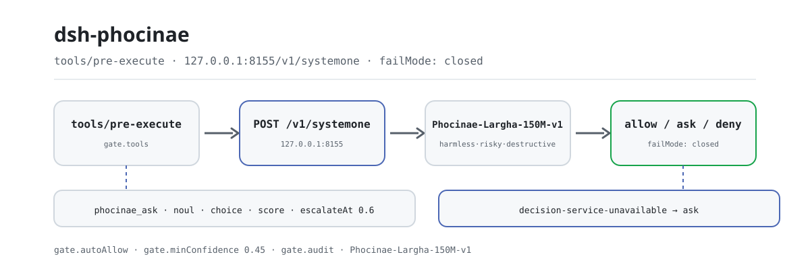
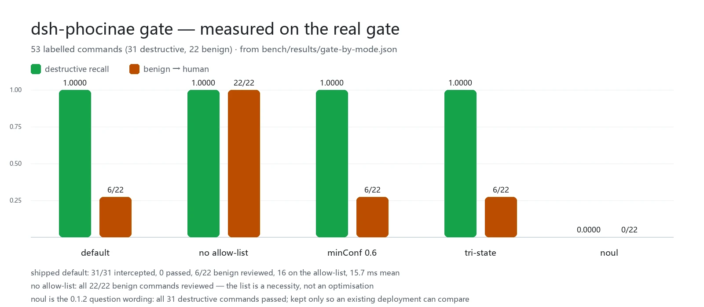

<div align="center">

<picture>
  <source media="(prefers-color-scheme: dark)" srcset="docs/assets/dsh-phocinae-flow-dark.svg">
  
</picture>

# dsh-phocinae

**Deja que un modelo local de 150M decida sobre cada llamada a herramienta antes de que se ejecute: sin API en la nube y sin tokens generados.**

Una capa de decisión no generativa para DeepSeek Harness: `phocinae_ask` responde lotes de preguntas sí/no, de opción única y de puntuación 2–10, mientras que `phocinae_gate` y la puerta `tools/pre-execute` convierten el mismo juicio en `allow` / `ask` / `deny`; si el servicio no responde, la llamada pasa a una persona en lugar de dejar pasar en silencio.

[Instalación](#instalación-en-tres-pasos) · [Configuración](#configuración) · [FAQ](#faq) · [简体中文](README.md) · [English](README.en.md) · [Español](README.es.md) · [Português](README.pt.md) · [हिन्दी](README.hi.md)

[](LICENSE)
[](#compatibilidad)
[](https://www.npmjs.com/package/dsh-phocinae)
[](#compatibilidad)

[](https://github.com/PerryLink/dsh-phocinae/stargazers)
[](https://www.npmjs.com/package/dsh-phocinae)
[](https://dshfind.com/plugins/PerryLink/dsh-phocinae?ref=badge)
[](https://gitee.com/perrylink/dsh-phocinae)

```sh
dsh plugin --profile <name> add dsh-phocinae
```

</div>

<sub>Plugin de la comunidad, sin relación con DeepSeek. Repositorio canónico: <https://github.com/PerryLink/dsh-phocinae> (Gitee es un espejo). El modelo y el servidor son proyectos separados: <https://huggingface.co/Phocinae/Phocinae-Largha-150M-v1>.</sub>

## Qué es

`dsh-phocinae` le quita un juicio al modelo grande: antes de que se ejecute una herramienta, el host entrega la llamada bruta a un `phocinae-server` local, donde un modelo no generativo de 150M parámetros devuelve una respuesta estructurada (sí/no, opción única, puntuación 2–10) en una sola pasada, con una confianza calibrada. La puerta mapea esa respuesta a `allow` / `ask` / `deny`; juzga, no ejecuta, no genera y no explica.

- **Sirve para**: comprobaciones frecuentes, umbralizables y repetibles — preselección de aprobaciones, enrutado, clasificación por lotes, puntuación de riesgo.
- **No sirve para**: escribir, resumir, traducir, responder preguntas de conocimiento o razonar sobre documentos largos; el modelo no tiene esas capacidades y preguntar igualmente devuelve una respuesta segura y vacía.

Ruta de una decisión: el host llama a `phocinae_ask`, a `phocinae_gate`, o la puerta automática se dispara en `tools/pre-execute` → el plugin hace `POST` del estado bruto a `http://127.0.0.1:8155/v1/systemone` → el servicio devuelve una respuesta estructurada por pregunta → la puerta mapea las respuestas a `allow` / `ask` / `deny`; la baja confianza se convierte en `escalate` y un servicio inaccesible se convierte en `ask` con `failMode: closed`.

## Instalación en tres pasos

1. **Arranca el servicio e instala el plugin.** El servicio va primero: el plugin no hace inferencia.

   ```sh
   # 1) servicio de decisión local (Python; el checkpoint ocupa unos 330 MB)
   pip install phocinae-server
   huggingface-cli download Phocinae/Phocinae-Largha-150M-v1 --local-dir ./model
   PHOC_MODEL_DIR=./model python -m phocinae.main

   # 2) el plugin (elige uno)
   dsh plugin --profile web add dsh-phocinae@0.2.5                # canal npm, versión fijada
   dsh plugin --profile web add github:PerryLink/dsh-phocinae     # canal git, main más reciente
   dsh plugin --profile web add ./dsh-phocinae-<version>.tgz      # canal tarball: tras npm pack
   ```

   > Fija `@0.2.5`: un `add dsh-phocinae` sin versión puede resolver a una compilación anterior mientras la ventana `minimumReleaseAge` de pnpm retiene una release reciente. Sin paso de compilación: `index.mjs`, `tools.mjs` y `lib/` son los artefactos publicados.

2. **Configuración mínima** (el bundle patch ya inserta una fila, así que los valores por defecto sirven; si prefieres explicitarlo, así):

   ```yaml
   - insert:
       - id: phocinae
         name: dsh-phocinae
         config:
           endpoint: http://127.0.0.1:8155/v1/systemone
           gate:
             mode: harm
             failMode: closed
   ```

3. **Comprueba que está activo**:

   ```sh
   curl http://127.0.0.1:8155/health
   dsh --profile web --dump-config | grep -A3 'id: phocinae'
   ```

   ```text
   {"status":"ok","model_loaded":true}
   ```

   `{"status":"ok","model_loaded":true}` significa que el servicio está listo; una fila `id: phocinae` en `--dump-config` significa que el bundle está montado. A partir de ahí, cada llamada filtrada pasa por la puerta en `tools/pre-execute`.

**Desinstalar**: `dsh plugin --profile web remove dsh-phocinae` (o quita la fila del profile patch).

## Capacidades principales

`dsh-phocinae` trabaja **fuera del límite del modelo**: no genera texto, solo convierte «¿debería ejecutarse, de qué tipo es, cuánto daño puede hacer?» en una respuesta estructurada y umbralizable.

- **`phocinae_ask`** — hasta 64 preguntas tipadas (`noul` / `choice` / `score`) sobre un mismo estado, resueltas en una pasada con respuestas, confianza calibrada y el indicador `escalate`.
- **`phocinae_gate`** — juzga un comando o acción como `allow` / `ask` / `deny`; comprueba sin ejecutar, así que encaja justo antes de actuar.
- **Puerta `tools/pre-execute`** — revisa cada llamada que coincide con `gate.tools` antes de ejecutarla; fail-closed, un servicio inaccesible pasa a una persona.
- **Skill `phocinae`** — indica al modelo cuándo una decisión local es la herramienta correcta y cómo leer `escalate`, para que nadie la use como modelo de chat.

### Orden de decisión

La puerta recorre un orden fijo y ningún paso lee «no he podido averiguarlo» como «es seguro»:

```text
herramienta fuera de gate.tools      -> allow   (sin petición)
comando en gate.autoAllow, sin operador -> allow   (sin petición)
el modelo dice destructive           -> deny
el modelo dice risky                 -> ask
el modelo dice harmless y confianza >= umbral -> allow
el modelo dice harmless pero confianza < umbral -> ask
servicio inaccesible / respuesta ilegible -> ask   (failMode: closed)
```

### Superficie de comandos y herramientas

| Superficie | Tipo | Qué hace |
|---|---|---|
| `phocinae_ask` | herramienta | Decisiones estructuradas por lotes; respuestas, confianza y `escalate` |
| `phocinae_gate` | herramienta | `allow` / `ask` / `deny` para un comando o acción |
| `tools/pre-execute` | gancho | Filtro automático antes de ejecutar; fail-closed |
| `phocinae` | skill | Cuándo usarla y cómo leer `escalate` |

### Ejemplos

Estos son los puntos de entrada reales del plugin; instala una vez y llama a uno.

Dos preguntas sobre un mismo estado:

```json
{"state":"El usuario quiere borrar /tmp/build. La ruta está dentro del workspace.","questions":[{"id":"safe","type":"noul","threshold":0.8},{"id":"urgency","type":"score"}]}
```

La forma de la respuesta es:

```json
{"answers":{"safe":true,"urgency":4},"confidence":{"safe":0.92,"urgency":0.71},"escalate":false}
```

Juzga un comando peligroso:

```json
{"command":"rm -rf /","toolName":"shell","cwd":"/home/me/project"}
```

Devuelve `decision: "deny"` con motivo y confianza; el comando nunca se ejecuta. Estas salidas ilustran el esquema, no son un fixture grabado.

## Datos medidos

<picture>
  <source media="(prefers-color-scheme: dark)" srcset="docs/assets/dsh-phocinae-evidence-en-dark.webp">
  
</picture>

Sobre 53 comandos etiquetados (31 destructivos / 22 benignos) con la puerta real (`lib/guard.mjs`): **la configuración de fábrica interceptó los 31 comandos destructivos, 0 pasaron**; solo 6/22 comandos benignos fueron a una persona, 16 usaron la lista de auto-permiso sin salir del proceso, y la media fue 15.7 ms. El recall a nivel de pregunta es otro número: `harm` 0.97, `tri-state` 0.74, `noul` 0.00; esos tres números son toda la razón de que `harm` sea el valor por defecto.

Latencia y coste: una decisión local (ida y vuelta HTTP, tokenize + pasada + composición de la respuesta) tarda 42.6 ms; filtrar un comando tarda 21 ms; un comando de la lista tarda 0.02 ms. La puerta es un gancho de `tools/pre-execute`, no un mensaje, así que **no consume tokens de sesión**; las dos definiciones de herramienta añaden 685 tokens fijos por petición, unos 234 tokens por decisión una vez amortizados.

El compromiso híbrido (conjunto typed oficial, 400 casos / 2000 decisiones): con τ=0.40 escala el 6.8% de los casos, ahorra el 93.3% de los tokens y obtiene 0.7305 (solo local 0.7320, solo modelo grande 0.7085); subir τ a 0.60 ahorra solo el 9.2% y obtiene 0.7115, por debajo de solo local.

Esos números son una instantánea puntual de `dsh-phocinae@0.2.1` del 2026-10-08; los criterios y la procedencia fila por fila están en [`bench/REPORT-0.2.1-measurements.md`](bench/REPORT-0.2.1-measurements.md), los resultados crudos en `bench/results/*.json`, y se regeneran con `node bench/gate-bench.mjs` y `node bench/token-savings.mjs`.

## Configuración

Los valores por defecto están en `cordis.patch.yml` y `lib/config.mjs`, y todas las claves tienen uno; un valor ilegal lanza un error **en la carga**, así que una mala configuración nunca llega a la puerta en ejecución. Una sobrescritura por id reemplaza la fila entera: repite todas las claves que necesites.

Claves más usadas:

| Clave | Valor por defecto | Significado |
|---|---|---|
| `endpoint` | `http://127.0.0.1:8155/v1/systemone` | Servicio de decisión; solo loopback salvo `allowRemoteEndpoint: true` |
| `timeoutMs` | `3000` | Tiempo por petición; un solo intento |
| `escalateAt` | `0.6` | Confianza por debajo de este valor marca `escalate: true` (una señal, no una promesa de ahorro de tokens) |
| `gate.mode` | `harm` | `harm` / `tri-state` / `noul` / `off` |
| `gate.tools` | `['*']` | Herramientas a revisar: nombre exacto, glob o `*` |
| `gate.failMode` | `closed` | `closed` pasa a una persona si el servicio no responde; `open` permite |
| `gate.autoAllow` | unos 95 verbos de lectura/build (el bundle patch incluye 14 en línea) | Prefijos de comando que pasan sin consultar al modelo; una entrada con operador de shell se rechaza en la carga |

<details>
<summary>Tabla completa de configuración (17 claves)</summary>

| Clave | Valor por defecto | Significado |
|---|---|---|
| `endpoint` | `http://127.0.0.1:8155/v1/systemone` | Servicio de decisión; solo loopback salvo `allowRemoteEndpoint: true` |
| `model` | `Phocinae-Largha-150M-v1` | Nombre del modelo en la petición; el servidor responde 422 para cualquier otro |
| `timeoutMs` | `3000` | Tiempo por petición; un solo intento |
| `escalateAt` | `0.6` | Confianza por debajo de este valor marca `escalate: true` (una señal, no una promesa de ahorro de tokens) |
| `maxStateChars` | `4096` | Límite de caracteres del estado renderizado; lo más largo se trunca por la cola y se marca |
| `permuteChoice` | `false` | Pide al servidor promediar por permutación las preguntas `choice` (4× pasadas) |
| `allowRemoteEndpoint` | `false` | Permite explícitamente un `endpoint` no loopback; desactivado porque el estado lleva texto bruto de comandos |
| `gate.enabled` | `true` | Interruptor general de la puerta de aprobación |
| `gate.mode` | `harm` | `harm` / `tri-state` / `noul` / `off` |
| `gate.threshold` | `0.8` | Solo modo `noul`: P(risky) a partir de este valor cuenta como señal positiva |
| `gate.escalateAt` | `0.6` | Umbral propio de revisión de la puerta (separado del `escalateAt` de las herramientas) |
| `gate.tools` | `['*']` | Herramientas a revisar: nombre exacto, glob o `*` |
| `gate.failMode` | `closed` | `closed` pasa a una persona si el servicio no responde; `open` permite |
| `gate.riskyDecision` | `deny` | Si un veredicto `risky` con confianza se convierte en `deny` o en `ask` |
| `gate.minConfidence` | `0.45` | Confianza que necesita un `allow`; por debajo, la llamada va a una persona (la confianza del modelo está comprimida, de ahí el umbral bajo) |
| `gate.autoAllow` | unos 95 verbos de lectura/build (el bundle patch incluye 14 en línea) | Prefijos de comando que pasan sin consultar al modelo; una entrada con operador de shell se rechaza en la carga |
| `gate.audit` | `true` | Una línea de log del host por veredicto (herramienta, veredicto, motivo, confianza) |

</details>

Para usar solo las herramientas y no revisar nada:

```yaml
- id: phocinae
  config:
    gate:
      mode: off
```

## FAQ

<details>
<summary>¿Qué pasa si el servicio de decisión se cae? ¿Falla en silencio dejando pasar?</summary>

Nada es silencioso. Con `failMode: closed` la puerta convierte la llamada filtrada en `ask` (motivo `decision-service-unavailable`), y la herramienta informa `PHOCINAE_SERVICE_UNAVAILABLE` indicando el comando que arranca el servicio. Un `deny` es un hallazgo positivo y ninguna confianza baja lo suaviza hasta permitir; una respuesta no 2xx, un cuerpo que no es JSON, una respuesta fuera de rango o la ausencia de la extensión `answer_confidence` se tratan como inaccesible o se marcan `escalate: true`, y tampoco se aprueban automáticamente.

</details>

<details>
<summary>¿A dónde va el texto de mis comandos?</summary>

Solo a `endpoint`, que por defecto es `127.0.0.1:8155`; una dirección no loopback es un error de carga salvo que actives `allowRemoteEndpoint: true` a propósito. El plugin no escribe ningún dominio de almacenamiento, no envía telemetría y no lee credenciales. Con `gate.audit` activo, cada veredicto registra una línea: herramienta + veredicto + motivo + confianza, nunca el texto del comando.

</details>

<details>
<summary>¿Choca con otros plugins por eventos o nombres de herramienta?</summary>

No. Solo se suscribe a `tools/pre-execute` y llama a `next()` exactamente una vez en la ruta de permiso; las herramientas son `phocinae_ask` y `phocinae_gate`, no ofrece ninguna clave de servicio, no registra prefijos `webServer` y no incluye mitad de cliente. El argumento punto por punto está en «Interoperabilidad con otros plugins de DSH».

</details>

<details>
<summary>¿Cuánto cuesta en rendimiento?</summary>

En CPU local una decisión tarda 42.6 ms (ida y vuelta HTTP), filtrar un comando tarda 21 ms de media y un comando de la lista 0.02 ms sin salir del proceso; la puerta es un gancho, así que 0 tokens de sesión, y el coste constante son 685 tokens por petición por las dos definiciones de herramienta. La precisión está en «Datos medidos».

</details>

<details>
<summary>¿Por qué no dejar que un modelo grande juzgue cada comando?</summary>

Puedes conectar `escalate` a un modelo grande, pero haz las cuentas primero: el modelo local de 150M es mejor en `choice` (0.7529 frente a 0.6793) y el grande solo gana en `noul` (0.7767 frente a 0.6833); escalar un caso entero de respuestas inciertas también reescribe las respuestas `choice` que ya eran correctas. Por eso τ debe ser bajo (0.30–0.40) y no el 0.6 de la tarjeta del modelo.

</details>

## Solución de problemas

| Síntoma | Solución |
|---|---|
| `PHOCINAE_SERVICE_UNAVAILABLE` | Arranca el servicio y comprueba `curl http://127.0.0.1:8155/health` |
| Un add sin versión instala una versión vieja | Reinstala con `dsh-phocinae@0.2.5`; confirma la versión en `dsh --profile web --dump-config` |
| La puerta pregunta por todo | Confirma que el servicio está activo; con `failMode: closed` un servicio caído pregunta a propósito: es el diseño, no un fallo |
| La puerta es demasiado estricta o laxa | Ajusta `gate.mode`, `gate.tools`, `gate.minConfidence`, `gate.autoAllow`; si cada comando debe verlo una persona, pon `gate.autoAllow` en `[]`, a cambio de revisar también los benignos |

## Límites de seguridad

- **Solo loopback.** El estado lleva texto bruto de la llamada; un `endpoint` no loopback es un error de carga salvo que se active `allowRemoteEndpoint: true` a propósito.
- **Fail-closed.** Los errores y tiempos de espera del servicio envían la llamada filtrada a una persona; una respuesta ausente o ilegible hace lo mismo; `deny` nunca se suaviza por baja confianza.
- **Una mala configuración falla en la carga.** Un `gate.mode` desconocido, un número fuera de rango, una entrada de `gate.autoAllow` con operador de shell y un endpoint no loopback lanzan error en la activación, nunca en la puerta en ejecución.
- **No es un sandbox.** La puerta es una señal de aprobación adicional, no sustituye al sandbox del host ni a la aprobación humana; según el contrato documentado, un `ask` se convierte en denegación en un despliegue sin servicio de aprobación, nunca en permiso silencioso.
- **No genera.** El modelo no responde preguntas de conocimiento, no escribe código ni resume; solo produce juicios estructurados.
- **Los registros son efectos.** Herramientas, skill y suscripción de eventos desaparecen con el ciclo de vida del plugin, así que una recarga en caliente no deja oyentes sueltos.

## Permisos y datos

- **Capacidades**: `dsh.capabilities` declara `network:egress` (solo hacia el servicio de decisión local) y `tools:register`.
- **Credenciales**: sin API key, no se lee ningún secreto del entorno; los pesos los descargas tú a tu máquina.
- **Datos**: sin dominio de almacenamiento, sin telemetría; el único dato saliente es el texto del estado, y su destino es el proceso local indicado por `endpoint`.

## Limitaciones conocidas

- **No genera.** No puede escribir, resumir, traducir, responder preguntas de conocimiento ni razonar sobre documentos largos; preguntar igualmente devuelve una respuesta segura y vacía.
- **La confianza está comprimida.** En el conjunto de 53 comandos la confianza de `allow` en `tri-state` cae en 0.27–0.54; en 2000 decisiones typed la mediana es 0.629. Por eso la lista de auto-permiso es una necesidad y no una optimización: quítala y los 22 comandos benignos van a una persona.
- **El recall de `noul` es 0.00.** Se conserva solo para que un despliegue existente compare lo viejo con lo nuevo en su propio tráfico; no es el valor por defecto y los despliegues nuevos no deberían usarlo.
- **El «ahorra 82% con τ=0.6» de la tarjeta del modelo no aplica.** Ese 82% pertenece a τ≈0.50, donde la precisión ya ha caído a 0.7065; en esta carga τ=0.60 ahorra solo el 9.2% y puntúa por debajo de solo local.
- **Necesita un segundo proceso de Python.** El plugin no hace inferencia: `phocinae-server` y un checkpoint de ~330 MB deben estar corriendo en local, con `/health` accesible.
- **64 preguntas por llamada y 4096 caracteres de estado**; lo más largo se trunca y se marca `[truncated]`, conservando la cabeza del comando.
- **Sin mitad de navegador.** El paquete no registra ningún slot de cliente; la interacción de `ask` / `deny` la asume la superficie de aprobación del host.

## Interoperabilidad con otros plugins de DSH

Verificado contra el corredor de DSH para el que se publica este README (`>=0.2.1-0 <0.3.0`) y contra la composición real de `test/integration/boot-headless.mjs`.

Este plugin **no interfiere** con otros plugins:

- **Sin colisión de nombres de herramienta.** Solo registra `phocinae_ask` y `phocinae_gate`, ambas con espacio de nombres.
- **Sin colisión de claves de servicio.** No ofrece ninguna clave de servicio, así que no puede chocar en una.
- **Sin colisión de slots.** No registra claves de slot de cliente y nunca compite por un asiento de UI.
- **Sin colisión de rutas HTTP.** No registra ningún prefijo `webServer`.
- **Sin colisión de capas de patch.** El bundle patch solo hace `insert` de su propia fila; nunca sobrescribe el `config` de una fila integrada.
- **Sin mutación global.** No parchea prototipos, no reescribe `process.env` ni sustituye el dispatcher global de fetch.

**Los eventos compartidos no interfieren.** Escucha el evento sensible al orden `tools/pre-execute` con la semántica de difusión de Cordis, donde todos los oyentes se ejecutan. **El oyente de este plugin llama a `next()` exactamente una vez, en la ruta de permiso**; `ask` / `deny` devuelven un `PreToolDecision` en lugar de llamar a `next(err)` (que rechazaría la cascada), así que no cortocircuita a los demás ni deja que una caída del servicio tumbe la cadena.

## Compatibilidad

| Superficie | Estado |
|---|---|
| Harness | DSH `>=0.2.1-0 <0.3.0`: la fila del bundle monta `phocinae_ask`, `phocinae_gate`, la puerta `tools/pre-execute` y la skill `phocinae` |
| Node | `^22.19.0 \|\| >=24.0.0` |
| Plataformas | Donde corra DSH; `gate.tools` cubre por defecto `pwsh` y `bash`, y la lista de auto-permiso incluye verbos de lectura de PowerShell y POSIX |
| Servicio de decisión | `phocinae-server` accesible en `127.0.0.1:8155`, con `/health` devolviendo `{"status":"ok","model_loaded":true}` |

## Ecosistema y calidad

- [Espejo en Gitee](https://gitee.com/perrylink/dsh-phocinae) (sincronizado por [.github/workflows/gitee-sync.yml](.github/workflows/gitee-sync.yml); GitHub es la referencia)
- [Página en dshfind](https://dshfind.com/plugins/PerryLink/dsh-phocinae) (instalaciones y ranking)
- [Base de conocimiento del ecosistema](https://perrylink.github.io/dsh-plugin-guide/): guía de desarrollo · datos de selección · criterios de mantenimiento

## Desarrollo

```sh
npm test                          # node --test: config / protocol / guard / contrato / regresiones
npm run test:integration          # puerta HTTP real + composición real de dsh
npm run bench:gate                # benchmark de la puerta sobre 53 comandos etiquetados
npm run bench:formulations        # comparación de formulaciones y separación
npm run verify:artifacts          # archivos publicados presentes + index.mjs importable
npm run check:readmes             # consistencia de los README en cinco idiomas
npm pack                          # el tarball publicado
```

Sin paso de compilación: ESM puro, `index.mjs`, `tools.mjs` y `lib/` son los artefactos publicados. Las pruebas tienen cinco capas (`lib` / `contract` / `regressions` / integración HTTP real / composición real de `dsh`); el servicio de decisión falso es una simplificación deliberada: lo que se afirma es el enrutado del veredicto, no que el modelo sea listo.

| Archivo | Responsabilidad |
|---|---|
| `index.mjs` | Activación: resolución de config, registro con `ctx.inject(['tools'])`, suscripción a `tools/pre-execute`, registro de la skill |
| `tools.mjs` | Las dos `ToolDefinition` (`phocinae_ask`, `phocinae_gate`), esquemas escritos a mano, sin dependencia en ejecución |
| `lib/config.mjs` | Resolución y validación de config, emparejamiento de herramientas y comandos |
| `lib/protocol.mjs` | Cliente de `/v1/systemone`, coerción de respuestas, formas de prompt |
| `lib/guard.mjs` | Reglas de veredicto y el oyente de `tools/pre-execute` |
| `lib/constants.mjs` | Vocabulario y valores por defecto (cero dependencias) |
| `lib/errors.mjs` | Códigos de error estructurados |
| `skills/phocinae/SKILL.md` | Texto de la skill: cuándo usarla, cómo leer `escalate` |

Las imágenes del README las genera [`scripts/gen-readme-assets.py`](scripts/gen-readme-assets.py) (Python + Pillow; aborta si no encuentra una fuente CJK): `python scripts/gen-readme-assets.py` se puede reejecutar y escribe `docs/assets/dsh-phocinae-flow-{light,dark}.svg` y `docs/assets/dsh-phocinae-evidence-{zh,en}-{light,dark}.webp`.

Topics: `dsh`, `dsh-plugin`, `deepseek-harness`, `deepseek`, `cordis`, `phocinae`, `decision-model`, `approval-gate`, `pre-tool-use`, `escalation`, `tool-routing`, `local-inference`, `cordis-plugin`

## Familia y agradecimientos

Este proyecto forma parte de la familia de plugins de DeepSeek Harness de [PerryLink](https://github.com/PerryLink) (todos Apache-2.0). Si te resulta útil, **una estrella ayuda a que la siguiente persona lo encuentre**; no desbloquea nada.

- [@PerryLink](https://github.com/PerryLink) — creador y mantenedor: el envoltorio del plugin sobre la capa de decisión local, la puerta fail-closed y su criterio de escala `harm`, la regla de operadores de la lista de auto-permiso y la documentación en cinco idiomas.
- El modelo de decisión y el servidor los mantiene por separado [Phocinae](https://huggingface.co/Phocinae): [Phocinae-Largha-150M-v1](https://huggingface.co/Phocinae/Phocinae-Largha-150M-v1) y [phocinae-server](https://github.com/Phocinae/phocinae-server).

## Licencia

[LICENSE](LICENSE) (Apache License 2.0) © 2026 dsh-phocinae contributors

<p align="center"><sub>Apache-2.0 · Plugin de la comunidad, sin relación con DeepSeek.</sub></p>
