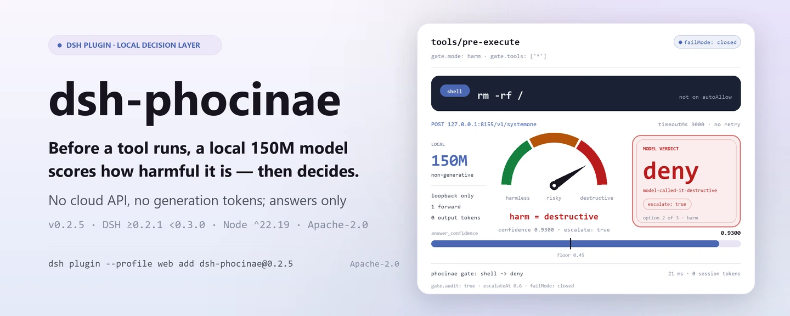
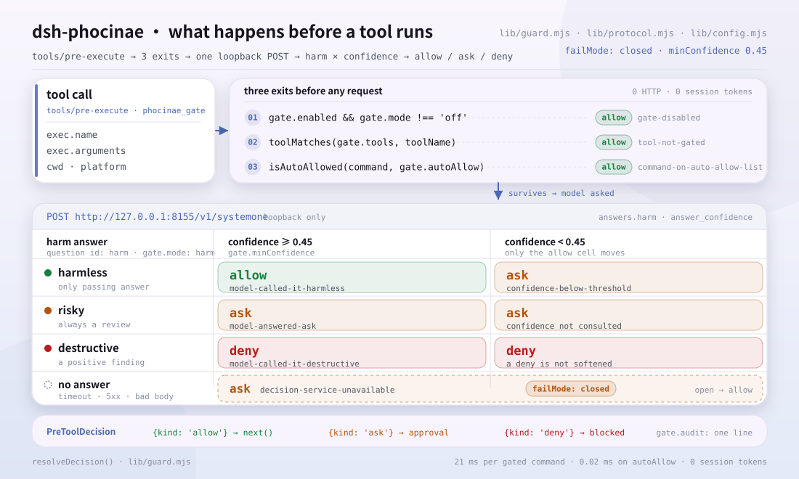
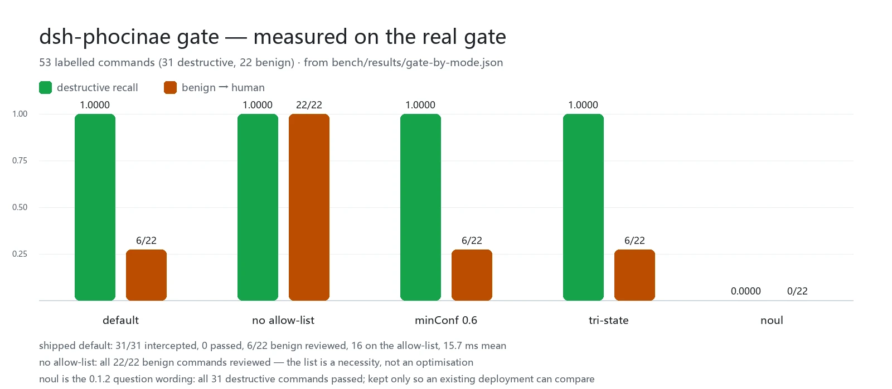

<div align="center">

<picture>
  <source media="(prefers-color-scheme: dark)" srcset="docs/assets/dsh-phocinae-hero-en-dark.webp">
  
</picture>

# dsh-phocinae

**हर टूल कॉल के असली में चलने से पहले एक स्थानीय 150M मॉडल से फ़ैसला लें — क्लाउड API नहीं, जनरेट किए गए token नहीं।**

DeepSeek Harness के लिए गैर-जनरेटिव निर्णय परत: `phocinae_ask` हाँ/नहीं, एकल चयन और 2–10 स्कोर वाले प्रश्नों के बैच का उत्तर देता है, और `phocinae_gate` तथा `tools/pre-execute` गेट उसी निर्णय को `allow` / `ask` / `deny` में बदल देते हैं; सेवा उपलब्ध न हो तो कॉल चुपचाप आगे बढ़ने के बजाय व्यक्ति के पास जाती है।

[इंस्टॉल](#तीन-चरणों-में-शुरुआत) · [कॉन्फ़िगरेशन](#कॉन्फ़िगरेशन) · [FAQ](#faq) · [简体中文](README.md) · [English](README.en.md) · [Español](README.es.md) · [Português](README.pt.md) · [हिन्दी](README.hi.md)

[](LICENSE)
[](#संगतता)
[](https://www.npmjs.com/package/dsh-phocinae)
[](#संगतता)

[](https://github.com/PerryLink/dsh-phocinae/stargazers)
[](https://www.npmjs.com/package/dsh-phocinae)
[](https://dshfind.com/plugins/PerryLink/dsh-phocinae?ref=badge)
[](https://gitee.com/perrylink/dsh-phocinae)

```sh
dsh plugin --profile <name> add dsh-phocinae
```

</div>

<sub>सामुदायिक प्लगइन, DeepSeek से आधिकारिक रूप से संबद्ध नहीं। एकमात्र रेपो: <https://github.com/PerryLink/dsh-phocinae> (Gitee प्रतिबिंब है)। निर्णय मॉडल और सर्वर अलग परियोजनाएँ हैं: <https://huggingface.co/Phocinae/Phocinae-Largha-150M-v1>।</sub>

## यह क्या है

<picture>
  <source media="(prefers-color-scheme: dark)" srcset="docs/assets/dsh-phocinae-flow-v5-dark.svg">
  
</picture>

`dsh-phocinae` एक फ़ैसला बड़े मॉडल से ले लेता है: टूल चलने से पहले होस्ट कच्ची कॉल स्थानीय `phocinae-server` को देता है, जहाँ 150M पैरामीटर वाला गैर-जनरेटिव मॉडल एक ही फ़ॉरवर्ड पास में संरचित उत्तर (हाँ/नहीं, एकल चयन, 2–10 स्कोर) कैलिब्रेटेड confidence के साथ लौटाता है। गेट उस उत्तर को `allow` / `ask` / `deny` में बदलता है; वह केवल निर्णय देता है — चलाता नहीं, लिखता नहीं, समझाता नहीं।

- **किसके लिए ठीक है**: बार-बार होने वाली, थ्रेशोल्ड पर तय होने वाली और दोहराई जा सकने वाली जाँचें — अनुमोदन की पूर्व-जाँच, रूटिंग, बैच वर्गीकरण, जोखिम स्कोरिंग।
- **किसके लिए नहीं**: लेखन, सारांश, अनुवाद, ज्ञान के प्रश्न या लंबे दस्तावेज़ों पर तर्क — मॉडल में ये क्षमताएँ नहीं हैं, और पूछने पर केवल आत्मविश्वासी खोखला उत्तर मिलेगा।

एक निर्णय का मार्ग: होस्ट `phocinae_ask` या `phocinae_gate` कॉल करता है, या स्वचालित गेट `tools/pre-execute` पर चलता है → प्लगइन कच्चा state `http://127.0.0.1:8155/v1/systemone` पर `POST` करता है → सेवा हर प्रश्न के लिए एक संरचित उत्तर देती है → गेट उत्तरों को `allow` / `ask` / `deny` में बदलता है; कम confidence `escalate` बनती है, और सेवा उपलब्ध न हो तो `failMode: closed` के तहत `ask` बनती है।

## तीन चरणों में शुरुआत

1. **सेवा शुरू करें और प्लगइन इंस्टॉल करें।** सेवा पहले चाहिए: प्लगइन स्वयं अनुमान नहीं करता।

   ```sh
   # 1) स्थानीय निर्णय सेवा (Python; checkpoint लगभग 330 MB)
   pip install phocinae-server
   huggingface-cli download Phocinae/Phocinae-Largha-150M-v1 --local-dir ./model
   PHOC_MODEL_DIR=./model python -m phocinae.main

   # 2) प्लगइन (एक चुनें)
   dsh plugin --profile web add dsh-phocinae@0.2.5                # npm चैनल, संस्करण पिन
   dsh plugin --profile web add github:PerryLink/dsh-phocinae     # git चैनल, नवीनतम main
   dsh plugin --profile web add ./dsh-phocinae-<version>.tgz      # tarball चैनल: npm pack के बाद
   ```

   > `@0.2.5` पिन करें: बिना संस्करण वाला `add dsh-phocinae` pnpm की `minimumReleaseAge` विंडो में पुरानी बिल्ड पर जा सकता है। कोई बिल्ड चरण नहीं — `index.mjs`, `tools.mjs` और `lib/` ही प्रकाशित आर्टिफ़ैक्ट हैं।

2. **न्यूनतम कॉन्फ़िगरेशन** (bundle patch पहले से एक पंक्ति जोड़ता है, इसलिए डिफ़ॉल्ट काम करते हैं; स्पष्ट लिखना हो तो ऐसे):

   ```yaml
   - insert:
       - id: phocinae
         name: dsh-phocinae
         config:
           endpoint: http://127.0.0.1:8155/v1/systemone
           gate:
             mode: harm
             failMode: closed
   ```

3. **जाँचें कि सक्रिय है**:

   ```sh
   curl http://127.0.0.1:8155/health
   dsh --profile web --dump-config | grep -A3 'id: phocinae'
   ```

   ```text
   {"status":"ok","model_loaded":true}
   ```

   `{"status":"ok","model_loaded":true}` का अर्थ है सेवा तैयार है; `--dump-config` में `id: phocinae` पंक्ति का अर्थ है bundle माउंट हो गया। इसके बाद हर जाँची जाने वाली टूल कॉल `tools/pre-execute` पर गेट से गुज़रती है।

**अनइंस्टॉल**: `dsh plugin --profile web remove dsh-phocinae` (या profile patch से वह पंक्ति हटा दें)।

## मुख्य क्षमताएँ

`dsh-phocinae` **मॉडल सीमा के बाहर** काम करता है: यह कोई टेक्स्ट नहीं बनाता, केवल «यह चलना चाहिए या नहीं, किस प्रकार का है, कितना गंभीर है» को एक थ्रेशोल्ड-योग्य संरचित उत्तर में बदलता है।

- **`phocinae_ask`** — एक ही state पर एक बार में 64 टाइप्ड प्रश्न (`noul` / `choice` / `score`), एक फ़ॉरवर्ड पास में उत्तर, कैलिब्रेटेड confidence और `escalate` फ़्लैग।
- **`phocinae_gate`** — एक कमांड या कार्रवाई को `allow` / `ask` / `deny` मानता है; बिना चलाए जाँचता है, इसलिए कार्रवाई से ठीक पहले पूछने के लिए उपयुक्त।
- **`tools/pre-execute` गेट** — `gate.tools` से मेल खाने वाली हर कॉल को चलने से पहले जाँचता है; fail-closed, सेवा उपलब्ध न हो तो व्यक्ति के पास जाती है।
- **`phocinae` skill** — मॉडल को बताती है कि स्थानीय निर्णय कब सही औज़ार है और `escalate` कैसे पढ़ें, ताकि कोई इसे चैट मॉडल की तरह इस्तेमाल न करे।

### निर्णय क्रम

गेट एक निश्चित क्रम चलाता है, और कोई भी चरण «पता नहीं चला» को «सुरक्षित है» नहीं पढ़ता:

```text
टूल gate.tools में नहीं है          -> allow   (कोई अनुरोध नहीं)
कमांड gate.autoAllow में, कोई ऑपरेटर नहीं -> allow   (कोई अनुरोध नहीं)
मॉडल कहता है destructive          -> deny
मॉडल कहता है risky                -> ask
मॉडल कहता है harmless और confidence >= सीमा -> allow
मॉडल कहता है harmless पर confidence < सीमा  -> ask
सेवा अनुपलब्ध / उत्तर अपठनीय       -> ask   (failMode: closed)
```

### कमांड और टूल सतह

| सतह | प्रकार | क्या करती है |
|---|---|---|
| `phocinae_ask` | टूल | बैच में संरचित निर्णय; उत्तर, confidence और `escalate` |
| `phocinae_gate` | टूल | एक कमांड या कार्रवाई के लिए `allow` / `ask` / `deny` |
| `tools/pre-execute` | हुक | चलने से पहले स्वचालित जाँच; fail-closed |
| `phocinae` | skill | कब उपयोग करें और `escalate` कैसे पढ़ें |

### उदाहरण

ये प्लगइन के असली प्रवेश बिंदु हैं; एक बार इंस्टॉल करें, फिर एक कॉल करें।

एक ही state पर दो प्रश्न:

```json
{"state":"उपयोगकर्ता /tmp/build हटाना चाहता है। रास्ता workspace के अंदर है।","questions":[{"id":"safe","type":"noul","threshold":0.8},{"id":"urgency","type":"score"}]}
```

उत्तर का आकार:

```json
{"answers":{"safe":true,"urgency":4},"confidence":{"safe":0.92,"urgency":0.71},"escalate":false}
```

खतरनाक कमांड जाँचें:

```json
{"command":"rm -rf /","toolName":"shell","cwd":"/home/me/project"}
```

यह `decision: "deny"` कारण और confidence के साथ लौटाता है; कमांड कभी नहीं चलता। ये आउटपुट schema दिखाते हैं, रिकॉर्ड किया गया fixture नहीं।

## मापे गए आंकड़े

<picture>
  <source media="(prefers-color-scheme: dark)" srcset="docs/assets/dsh-phocinae-evidence-en-dark.webp">
  
</picture>

असली गेट (`lib/guard.mjs`) से 53 लेबल वाले कमांड (31 खतरनाक / 22 सुरक्षित) पर: **डिफ़ॉल्ट कॉन्फ़िगरेशन ने सभी 31 खतरनाक कमांड पकड़े, 0 बचे**; केवल 6/22 सुरक्षित कमांड व्यक्ति के पास गए, 16 autoAllow सूची से प्रक्रिया छोड़े बिना निकले, और औसत 15.7 ms रहा। प्रश्न-स्तर का recall दूसरा आंकड़ा है: `harm` 0.97, `tri-state` 0.74, `noul` 0.00 — यही तीन आंकड़े `harm` के डिफ़ॉल्ट होने का पूरा कारण हैं।

विलंब और लागत: एक स्थानीय निर्णय (HTTP राउंड ट्रिप, tokenize + फ़ॉरवर्ड + उत्तर संयोजन) 42.6 ms लेता है; एक कमांड की जाँच 21 ms; सूची वाला कमांड 0.02 ms। गेट `tools/pre-execute` का हुक है, संदेश नहीं, इसलिए **कोई सेशन token नहीं लेता**; दो टूल परिभाषाएँ प्रति अनुरोध 685 token जोड़ती हैं, जो प्रति निर्णय लगभग 234 token बनते हैं।

हाइब्रिड समझौता (आधिकारिक typed सेट, 400 केस / 2000 निर्णय): τ=0.40 पर 6.8% केस escalate होते हैं, 93.3% token बचते हैं, और सटीकता 0.7305 रहती है (केवल स्थानीय 0.7320, केवल बड़ा मॉडल 0.7085); τ को 0.60 करने पर केवल 9.2% बचता है और सटीकता 0.7115 रहती है, जो केवल स्थानीय से कम है।

ये आंकड़े `dsh-phocinae@0.2.1` का 2026-10-08 का एकबारगी स्नैपशॉट हैं; मानदंड और पंक्ति-दर-पंक्ति स्रोत [`bench/REPORT-0.2.1-measurements.md`](bench/REPORT-0.2.1-measurements.md) में हैं, कच्चे परिणाम `bench/results/*.json` में, और `node bench/gate-bench.mjs` तथा `node bench/token-savings.mjs` से दोबारा बनाए जा सकते हैं।

## कॉन्फ़िगरेशन

डिफ़ॉल्ट `cordis.patch.yml` और `lib/config.mjs` में हैं, और हर key का एक डिफ़ॉल्ट है; ग़लत मान **लोड के समय** ही त्रुटि देता है, इसलिए ख़राब कॉन्फ़िगरेशन चलते हुए गेट तक कभी नहीं पहुँचता। id के आधार पर ओवरराइड पूरी पंक्ति बदल देता है — जो key चाहिए, सब दोहराएँ।

सबसे उपयोगी keys:

| Key | डिफ़ॉल्ट | अर्थ |
|---|---|---|
| `endpoint` | `http://127.0.0.1:8155/v1/systemone` | निर्णय सेवा; `allowRemoteEndpoint: true` के बिना केवल loopback |
| `timeoutMs` | `3000` | प्रति अनुरोध समय; एक ही प्रयास |
| `escalateAt` | `0.6` | इससे कम confidence `escalate: true` करता है (संकेत, token बचत का दावा नहीं) |
| `gate.mode` | `harm` | `harm` / `tri-state` / `noul` / `off` |
| `gate.tools` | `['*']` | जाँचने वाले टूल: सटीक नाम, glob या `*` |
| `gate.failMode` | `closed` | सेवा उपलब्ध न हो तो `closed` व्यक्ति से पूछता है, `open` अनुमति देता है |
| `gate.autoAllow` | लगभग 95 पढ़ने/बिल्ड वाले क्रियापद (bundle patch इनमें से 14 इनलाइन करता है) | बिना मॉडल पूछे पास होने वाले कमांड प्रीफ़िक्स; shell ऑपरेटर वाली प्रविष्टि लोड पर अस्वीकृत |

<details>
<summary>पूरी कॉन्फ़िगरेशन तालिका (17 keys)</summary>

| Key | डिफ़ॉल्ट | अर्थ |
|---|---|---|
| `endpoint` | `http://127.0.0.1:8155/v1/systemone` | निर्णय सेवा; `allowRemoteEndpoint: true` के बिना केवल loopback |
| `model` | `Phocinae-Largha-150M-v1` | अनुरोध में मॉडल नाम; बाकी किसी मान पर सर्वर 422 देता है |
| `timeoutMs` | `3000` | प्रति अनुरोध समय; एक ही प्रयास |
| `escalateAt` | `0.6` | इससे कम confidence `escalate: true` करता है (संकेत, token बचत का दावा नहीं) |
| `maxStateChars` | `4096` | रेंडर किए state की अक्षर सीमा; अधिक हिस्सा पूँछ से काटा जाता है और चिह्नित होता है |
| `permuteChoice` | `false` | सेवा से `choice` प्रश्नों का क्रम-औसत कराना (4× फ़ॉरवर्ड) |
| `allowRemoteEndpoint` | `false` | गैर-loopback `endpoint` की स्पष्ट अनुमति; बंद, क्योंकि state में कच्चा कमांड टेक्स्ट होता है |
| `gate.enabled` | `true` | अनुमोदन गेट का मुख्य स्विच |
| `gate.mode` | `harm` | `harm` / `tri-state` / `noul` / `off` |
| `gate.threshold` | `0.8` | केवल `noul` मोड: इससे ऊपर P(risky) सकारात्मक संकेत माना जाता है |
| `gate.escalateAt` | `0.6` | गेट की अपनी समीक्षा सीमा (टूल की `escalateAt` से अलग) |
| `gate.tools` | `['*']` | जाँचने वाले टूल: सटीक नाम, glob या `*` |
| `gate.failMode` | `closed` | सेवा उपलब्ध न हो तो `closed` व्यक्ति से पूछता है, `open` अनुमति देता है |
| `gate.riskyDecision` | `deny` | भरोसेमंद `risky` निर्णय `deny` बने या `ask` |
| `gate.minConfidence` | `0.45` | `allow` के लिए चाहिए confidence; इससे कम हो तो कॉल व्यक्ति के पास जाती है (मॉडल की confidence संकुचित है, इसलिए सीमा नीची) |
| `gate.autoAllow` | लगभग 95 पढ़ने/बिल्ड वाले क्रियापद (bundle patch इनमें से 14 इनलाइन करता है) | बिना मॉडल पूछे पास होने वाले कमांड प्रीफ़िक्स; shell ऑपरेटर वाली प्रविष्टि लोड पर अस्वीकृत |
| `gate.audit` | `true` | प्रति निर्णय होस्ट लॉग की एक पंक्ति (टूल, निर्णय, कारण, confidence) |

</details>

केवल टूल चलाएँ, कुछ भी जाँचे बिना:

```yaml
- id: phocinae
  config:
    gate:
      mode: off
```

## FAQ

<details>
<summary>निर्णय सेवा बंद हो जाए तो क्या होगा? क्या चुपचाप अनुमति दे देगा?</summary>

कुछ भी चुपचाप नहीं होता। `failMode: closed` के तहत गेट जाँची गई कॉल को `ask` बना देता है (कारण `decision-service-unavailable`), और टूल `PHOCINAE_SERVICE_UNAVAILABLE` बताते हुए सेवा शुरू करने का कमांड देता है। `deny` एक सकारात्मक निष्कर्ष है और कोई कम confidence उसे ढीला करके अनुमति नहीं बनाती; गैर-2xx उत्तर, JSON नहीं होने वाला body, सीमा से बाहर उत्तर या `answer_confidence` एक्सटेंशन का अभाव — सब या तो अनुपलब्ध माने जाते हैं या `escalate: true` चिह्नित होते हैं, और स्वतः पास नहीं होते।

</details>

<details>
<summary>मेरे कमांड का टेक्स्ट कहाँ जाता है?</summary>

केवल `endpoint` पर, जो डिफ़ॉल्ट रूप से `127.0.0.1:8155` है; गैर-loopback पता लोड के समय त्रुटि है, जब तक आप जानबूझकर `allowRemoteEndpoint: true` न सेट करें। प्लगइन कोई स्टोरेज डोमेन नहीं लिखता, कोई टेलीमेट्री नहीं भेजता और कोई क्रेडेंशियल नहीं पढ़ता। `gate.audit` चालू होने पर हर निर्णय की एक पंक्ति लॉग होती है: टूल + निर्णय + कारण + confidence — कमांड का टेक्स्ट कभी नहीं।

</details>

<details>
<summary>क्या यह दूसरे प्लगइन से इवेंट या टूल नाम पर टकराता है?</summary>

नहीं। यह केवल `tools/pre-execute` की सदस्यता लेता है और allow मार्ग पर ठीक एक बार `next()` कहता है; टूल `phocinae_ask` और `phocinae_gate` हैं, कोई सर्विस key नहीं देता, कोई `webServer` प्रीफ़िक्स पंजीकृत नहीं करता और इसका कोई क्लाइंट हिस्सा नहीं है। बिंदु-दर-बिंदु तर्क «अन्य DSH प्लगइन के साथ अंतर-संचालन» में है।

</details>

<details>
<summary>प्रदर्शन पर कितना भार है?</summary>

स्थानीय CPU पर एक निर्णय 42.6 ms लेता है (HTTP राउंड ट्रिप), कमांड की जाँच औसतन 21 ms, और सूची वाला कमांड प्रक्रिया छोड़े बिना 0.02 ms; गेट हुक है, इसलिए 0 सेशन token, और स्थिर लागत दो टूल परिभाषाओं के लिए प्रति अनुरोध 685 token है। सटीकता «मापे गए आंकड़े» में है।

</details>

<details>
<summary>हर कमांड का फ़ैसला सीधे बड़े मॉडल से क्यों न लें?</summary>

`escalate` को बड़े मॉडल से जोड़ा जा सकता है, पर पहले हिसाब लगाएँ: स्थानीय 150M मॉडल `choice` में बेहतर है (0.7529 बनाम 0.6793) और बड़ा मॉडल केवल `noul` में जीतता है (0.7767 बनाम 0.6833); अनिश्चित उत्तरों वाले पूरे केस को escalate करने से वे `choice` उत्तर भी बदल जाते हैं जो पहले सही थे। इसलिए τ नीचा (0.30–0.40) रखें, मॉडल कार्ड के 0.6 पर नहीं।

</details>

## समस्या निवारण

| लक्षण | समाधान |
|---|---|
| `PHOCINAE_SERVICE_UNAVAILABLE` | सेवा शुरू करें और `curl http://127.0.0.1:8155/health` जाँचें |
| बिना संस्करण add पुराना संस्करण लाता है | `dsh-phocinae@0.2.5` से फिर इंस्टॉल करें; `dsh --profile web --dump-config` से संस्करण देखें |
| गेट हर चीज़ पूछता है | जाँचें कि सेवा चल रही है; `failMode: closed` में सेवा बंद होना जानबूझकर पूछता है — यह डिज़ाइन है, ख़राबी नहीं |
| गेट बहुत सख़्त या बहुत ढीला है | `gate.mode`, `gate.tools`, `gate.minConfidence`, `gate.autoAllow` समायोजित करें; अगर हर कमांड किसी व्यक्ति को दिखना चाहिए तो `gate.autoAllow` को `[]` करें, पर तब सुरक्षित कमांड भी समीक्षा में जाएँगे |

## सुरक्षा सीमाएँ

- **केवल loopback।** state में कच्चा टूल कॉल टेक्स्ट है; गैर-loopback `endpoint` लोड के समय त्रुटि है, जब तक जानबूझकर `allowRemoteEndpoint: true` न सेट हो।
- **Fail-closed।** सेवा की त्रुटि या timeout जाँची गई कॉल को व्यक्ति के पास भेजते हैं; अनुपस्थित या अपठनीय उत्तर भी वही करता है; `deny` को कम confidence कभी ढीला नहीं करती।
- **ग़लत कॉन्फ़िगरेशन लोड ही विफल करता है।** अज्ञात `gate.mode`, सीमा से बाहर संख्या, shell ऑपरेटर वाली `gate.autoAllow` प्रविष्टि और गैर-loopback endpoint — सब सक्रियण पर त्रुटि देते हैं, चलते गेट पर कभी नहीं।
- **यह sandbox नहीं है।** गेट एक अतिरिक्त अनुमोदन संकेत है, होस्ट sandbox या मानव अनुमोदन का विकल्प नहीं; दस्तावेज़ी अनुबंध के अनुसार जिस deployment में अनुमोदन सेवा नहीं है, वहाँ `ask` इनकार बनता है, चुपचाप अनुमति नहीं।
- **कुछ नहीं बनाता।** मॉडल ज्ञान के प्रश्न, कोड या सारांश नहीं देता; केवल संरचित निर्णय देता है।
- **पंजीकरण effect हैं।** टूल, skill और इवेंट सदस्यता प्लगइन के जीवनकाल के साथ हट जाते हैं, इसलिए हॉट रीलोड कोई भटका हुआ लिसनर नहीं छोड़ता।

## अनुमतियाँ और डेटा

- **क्षमताएँ**: `dsh.capabilities` में `network:egress` (केवल स्थानीय निर्णय सेवा तक) और `tools:register` घोषित हैं।
- **क्रेडेंशियल**: कोई API key नहीं, पर्यावरण से कोई रहस्य नहीं पढ़ा जाता; वज़न आप स्वयं अपनी मशीन पर डाउनलोड करते हैं।
- **डेटा**: कोई स्टोरेज डोमेन नहीं, कोई टेलीमेट्री नहीं; बाहर जाने वाला एकमात्र डेटा state टेक्स्ट है, और उसका गंतव्य `endpoint` वाली स्थानीय प्रक्रिया है।

## ज्ञात सीमाएँ

- **कुछ नहीं बनाता।** लिखना, सारांश, अनुवाद, ज्ञान के प्रश्न या लंबे दस्तावेज़ों पर तर्क नहीं कर सकता; पूछने पर आत्मविश्वासी खोखला उत्तर मिलेगा।
- **Confidence संकुचित है।** 53 कमांड के सेट पर `tri-state` की `allow` confidence 0.27–0.54 में रहती है; 2000 typed निर्णयों पर मध्यक 0.629 है। इसीलिए autoAllow सूची अनुकूलन नहीं, आवश्यकता है — उसे हटाएँ तो सभी 22 सुरक्षित कमांड व्यक्ति के पास जाते हैं।
- **`noul` का recall 0.00 है।** यह केवल इसलिए रखा गया है कि मौजूदा deployment अपने ट्रैफ़िक पर पुराने और नए व्यवहार की तुलना कर सके; यह डिफ़ॉल्ट नहीं है और नए deployment को नहीं अपनाना चाहिए।
- **मॉडल कार्ड का «τ=0.6 पर 82% बचत» लागू नहीं होता।** वह 82% τ≈0.50 का है, जहाँ सटीकता पहले ही 0.7065 पर गिर चुकी है; इस कार्यभार पर τ=0.60 केवल 9.2% बचाता है और केवल स्थानीय से कम स्कोर करता है।
- **एक दूसरी Python प्रक्रिया चाहिए।** प्लगइन अनुमान नहीं करता: `phocinae-server` और लगभग 330 MB का checkpoint स्थानीय रूप से चलना चाहिए, और `/health` उपलब्ध होना चाहिए।
- **प्रति कॉल 64 प्रश्न, state की सीमा 4096 अक्षर**; अधिक हिस्सा काटा जाता है और `[truncated]` चिह्नित होता है, कमांड का सिरा बचा रहता है।
- **कोई ब्राउज़र हिस्सा नहीं।** पैकेज कोई क्लाइंट slot पंजीकृत नहीं करता; `ask` / `deny` की बातचीत होस्ट की अनुमोदन सतह संभालती है।

## अन्य DSH प्लगइन के साथ अंतर-संचालन

यह README जिस DSH कॉरिडोर (`>=0.2.1-0 <0.3.0`) के लिए है, उसके विरुद्ध और `test/integration/boot-headless.mjs` की असली रचना के विरुद्ध सत्यापित।

यह प्लगइन दूसरे प्लगइन में **दखल नहीं देता**:

- **टूल नाम का टकराव नहीं।** केवल `phocinae_ask` और `phocinae_gate` पंजीकृत होते हैं, दोनों नेमस्पेस वाले।
- **सर्विस key का टकराव नहीं।** कोई सर्विस key नहीं देता, इसलिए टकराव संभव ही नहीं।
- **slot का टकराव नहीं।** कोई क्लाइंट slot key पंजीकृत नहीं करता और UI सीट के लिए कभी नहीं लड़ता।
- **HTTP रूट का टकराव नहीं।** कोई `webServer` प्रीफ़िक्स पंजीकृत नहीं करता।
- **patch परत का टकराव नहीं।** bundle patch केवल अपनी पंक्ति `insert` करता है; किसी अंतर्निहित पंक्ति का `config` कभी नहीं लिखता।
- **कोई वैश्विक बदलाव नहीं।** prototypes नहीं बदलता, `process.env` नहीं लिखता, वैश्विक fetch dispatcher नहीं बदलता।

**साझा इवेंट आपस में नहीं टकराते।** यह क्रम-संवेदी `tools/pre-execute` को Cordis के broadcast अर्थ में सुनता है, जहाँ हर लिसनर चलता है। **यहाँ का लिसनर allow मार्ग पर ठीक एक बार `next()` कहता है**; `ask` / `deny` `next(err)` के बजाय `PreToolDecision` लौटाते हैं (जो वॉटरफ़ॉल को अस्वीकार कर देता), इसलिए यह न दूसरों को शॉर्ट-सर्किट करता है, न सेवा ठप होने पर पूरी श्रृंखला गिराता है।

## संगतता

| सतह | स्थिति |
|---|---|
| Harness | DSH `>=0.2.1-0 <0.3.0`: bundle पंक्ति `phocinae_ask`, `phocinae_gate`, `tools/pre-execute` गेट और `phocinae` skill माउंट करती है |
| Node | `^22.19.0 \|\| >=24.0.0` |
| प्लेटफ़ॉर्म | जहाँ DSH चले; `gate.tools` डिफ़ॉल्ट में `pwsh` और `bash` दोनों हैं, और autoAllow में PowerShell तथा POSIX पढ़ने वाले क्रियापद भी |
| निर्णय सेवा | `phocinae-server` `127.0.0.1:8155` पर उपलब्ध, `/health` से `{"status":"ok","model_loaded":true}` |

## पारिस्थितिकी और गुणवत्ता

- [Gitee प्रतिबिंब](https://gitee.com/perrylink/dsh-phocinae) ([.github/workflows/gitee-sync.yml](.github/workflows/gitee-sync.yml) से सिंक; GitHub प्रामाणिक है)
- [dshfind प्लगइन पृष्ठ](https://dshfind.com/plugins/PerryLink/dsh-phocinae) (इंस्टॉल और रैंकिंग)
- [पारिस्थितिकी ज्ञानकोश](https://perrylink.github.io/dsh-plugin-guide/): प्लगइन विकास गाइड · चयन के मापे आंकड़े · रखरखाव के मानदंड

## विकास

```sh
npm test                          # node --test: config / protocol / guard / अनुबंध / रिग्रेशन
npm run test:integration          # असली HTTP गेट + असली dsh रचना
npm run bench:gate                # 53 लेबल वाले कमांड पर गेट बेंचमार्क
npm run bench:formulations        # प्रॉम्प्ट शब्दांकन तुलना और पृथक्करण
npm run verify:artifacts          # प्रकाशित फ़ाइलें मौजूद + index.mjs आयात योग्य
npm run check:readmes             # पाँच भाषाओं के README की स्थिरता
npm pack                          # प्रकाशित tarball
```

कोई बिल्ड चरण नहीं: शुद्ध ESM, `index.mjs`, `tools.mjs` और `lib/` ही प्रकाशित आर्टिफ़ैक्ट हैं। परीक्षण पाँच परतों में हैं (`lib` / `contract` / `regressions` / असली HTTP एकीकरण / असली `dsh` रचना); नकली निर्णय सेवा जानबूझकर सरलीकरण है — दावा निर्णय के मार्ग का है, मॉडल के चतुर होने का नहीं।

| फ़ाइल | ज़िम्मेदारी |
|---|---|
| `index.mjs` | सक्रियण: config हल करना, `ctx.inject(['tools'])` से टूल पंजीकरण, `tools/pre-execute` सदस्यता, skill पंजीकरण |
| `tools.mjs` | दो `ToolDefinition` (`phocinae_ask`, `phocinae_gate`), हाथ से लिखे schema, कोई रनटाइम निर्भरता नहीं |
| `lib/config.mjs` | config हल करना और सत्यापन, टूल नाम और कमांड मिलान |
| `lib/protocol.mjs` | `/v1/systemone` क्लाइंट, उत्तर को जोड़ना, प्रॉम्प्ट आकार |
| `lib/guard.mjs` | निर्णय नियम और `tools/pre-execute` लिसनर |
| `lib/constants.mjs` | शब्दावली और डिफ़ॉल्ट (शून्य निर्भरता) |
| `lib/errors.mjs` | संरचित त्रुटि कोड |
| `skills/phocinae/SKILL.md` | skill पाठ: कब उपयोग करें, `escalate` कैसे पढ़ें |

README की तस्वीरें [`scripts/gen-readme-assets.py`](scripts/gen-readme-assets.py) से बनती हैं (Python + Pillow; CJK फ़ॉन्ट न मिले तो स्पष्ट त्रुटि देकर रुकता है): `python scripts/gen-readme-assets.py` दोबारा चलाया जा सकता है और `docs/assets/dsh-phocinae-hero-{zh,en}-{light,dark}.webp` तथा `docs/assets/dsh-phocinae-flow-v5-{light,dark}.svg` लिखता है; `--evidence` अलग से `docs/assets/dsh-phocinae-evidence-{zh,en}-{light,dark}.webp` फिर बनाता है।

Topics: `dsh`, `dsh-plugin`, `deepseek-harness`, `deepseek`, `cordis`, `phocinae`, `decision-model`, `approval-gate`, `pre-tool-use`, `escalation`, `tool-routing`, `local-inference`, `cordis-plugin`

## परिवार और आभार

यह परियोजना [PerryLink](https://github.com/PerryLink) द्वारा रखरखाव किए जाने वाले DeepSeek Harness प्लगइन परिवार का हिस्सा है (सभी Apache-2.0)। अगर यह उपयोगी है, **एक star अगले व्यक्ति को इसे खोजने में मदद करता है** — इसके पीछे कोई सुविधा नहीं है।

- [@PerryLink](https://github.com/PerryLink) — निर्माता और रखरखावकर्ता: स्थानीय निर्णय परत के ऊपर प्लगइन आवरण, fail-closed गेट और उसका `harm` स्केल मानदंड, autoAllow ऑपरेटर नियम, और पाँच भाषाओं का दस्तावेज़।
- निर्णय मॉडल और सर्वर अलग से [Phocinae](https://huggingface.co/Phocinae) द्वारा रखरखाव किए जाते हैं: [Phocinae-Largha-150M-v1](https://huggingface.co/Phocinae/Phocinae-Largha-150M-v1) और [phocinae-server](https://github.com/Phocinae/phocinae-server)।

## लाइसेंस

[LICENSE](LICENSE) (Apache License 2.0) © 2026 dsh-phocinae contributors

<p align="center"><sub>Apache-2.0 · सामुदायिक प्लगइन, DeepSeek से संबद्ध नहीं।</sub></p>
