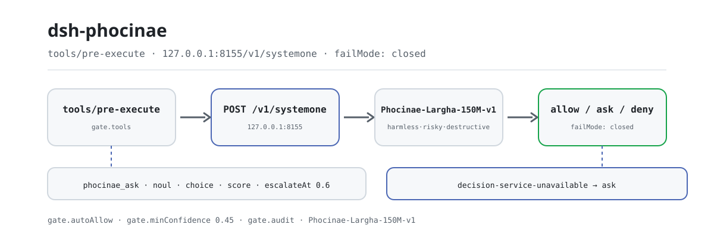
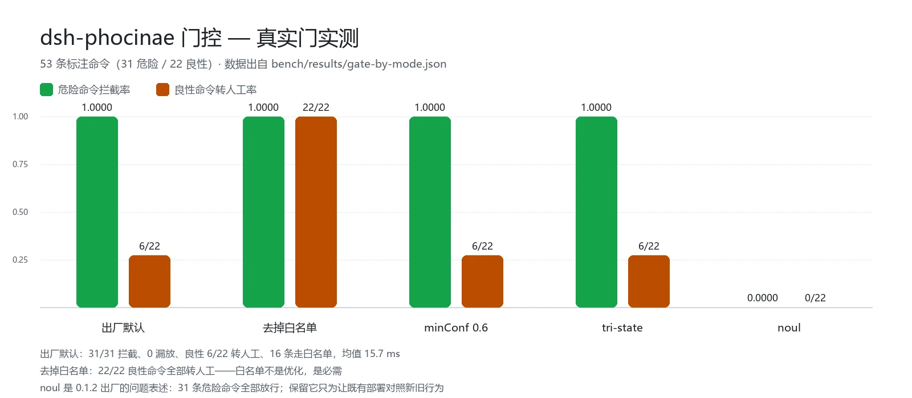

<div align="center">

<picture>
  <source media="(prefers-color-scheme: dark)" srcset="docs/assets/dsh-phocinae-flow-dark.svg">
  
</picture>

# dsh-phocinae

**在工具真正执行之前，让本机 150M 参数模型给每个调用一次结构化裁决——不调云 API，不花生成 token。**

面向 DeepSeek Harness 的非生成式决策层：`phocinae_ask` 回答批量的是/否、单选与 2–10 评分，`phocinae_gate` 与 `tools/pre-execute` 门把同一个判断变成 `allow` / `ask` / `deny`，服务不可达时转人工而不是静默放行。

[安装](#三步上手) · [配置](#配置) · [FAQ](#faq) · [简体中文](README.md) · [English](README.en.md) · [Español](README.es.md) · [Português](README.pt.md) · [हिन्दी](README.hi.md)

[](LICENSE)
[](#兼容性)
[](https://www.npmjs.com/package/dsh-phocinae)
[](#兼容性)

[](https://github.com/PerryLink/dsh-phocinae/stargazers)
[](https://www.npmjs.com/package/dsh-phocinae)
[](https://dshfind.com/plugins/PerryLink/dsh-phocinae?ref=badge)
[](https://gitee.com/perrylink/dsh-phocinae)

```sh
dsh plugin --profile <name> add dsh-phocinae
```

</div>

<sub>社区插件，与 DeepSeek 官方无关。唯一仓库：<https://github.com/PerryLink/dsh-phocinae>（Gitee 为镜像）。决策模型与服务是独立项目：<https://huggingface.co/Phocinae/Phocinae-Largha-150M-v1>。</sub>

## 它是什么

`dsh-phocinae` 把「一次判断」从大模型手里拿走：宿主在工具执行前把原始调用交给本机 `phocinae-server`，一个 150M 参数的非生成式模型用一次前向返回结构化答案（是/否、单选、2–10 评分），附校准置信度。门把答案映射成 `allow` / `ask` / `deny`；它只判断，不执行、不生成、不解释。

- **适合**：需要高频、可阈值化、可复现的检查——命令审批预筛、路由分流、批量分类、风险打分。
- **不适合**：写作、总结、翻译、知识问答、长文档推理——模型没有这些能力，硬问只会得到自信而空洞的答案。

一次裁决的路径：宿主调用 `phocinae_ask`、`phocinae_gate`，或自动门在 `tools/pre-execute` 触发 → 插件把原始 state `POST` 到 `http://127.0.0.1:8155/v1/systemone` → 服务对每个问题返回一个结构化答案 → 门把答案映射成 `allow` / `ask` / `deny`；低置信度变成 `escalate`，服务不可达在 `failMode: closed` 下变成 `ask`。

## 三步上手

1. **起服务并装上插件**。服务是前置：插件本身不做推理。

   ```sh
   # 1) 本机决策服务（Python；模型约 330 MB）
   pip install phocinae-server
   huggingface-cli download Phocinae/Phocinae-Largha-150M-v1 --local-dir ./model
   PHOC_MODEL_DIR=./model python -m phocinae.main

   # 2) 插件（三选一）
   dsh plugin --profile web add dsh-phocinae@0.2.5                # npm 通道，固定版本
   dsh plugin --profile web add github:PerryLink/dsh-phocinae     # git 通道，最新 main
   dsh plugin --profile web add ./dsh-phocinae-<version>.tgz      # tarball 通道：npm pack 后
   ```

   > 请固定 `@0.2.5`：直接 `add dsh-phocinae` 可能在 pnpm 的 `minimumReleaseAge` 窗口内解析到更旧的构建。无构建步骤——`index.mjs`、`tools.mjs` 与 `lib/` 即发布产物。

2. **最小配置**（bundle patch 已自动插入一行，默认即可用；要显式写就这样）：

   ```yaml
   - insert:
       - id: phocinae
         name: dsh-phocinae
         config:
           endpoint: http://127.0.0.1:8155/v1/systemone
           gate:
             mode: harm
             failMode: closed
   ```

3. **验证已生效**：

   ```sh
   curl http://127.0.0.1:8155/health
   dsh --profile web --dump-config | grep -A3 'id: phocinae'
   ```

   ```text
   {"status":"ok","model_loaded":true}
   ```

   `{"status":"ok","model_loaded":true}` 表示服务就绪；`--dump-config` 里能看到 `id: phocinae` 这一行，说明 bundle 已挂载。之后每次被筛查的工具调用都会在 `tools/pre-execute` 上过一遍门。

**卸载**：`dsh plugin --profile web remove dsh-phocinae`（或从 profile patch 删掉该行）。

## 核心能力

`dsh-phocinae` 在**模型边界之外**工作：它不生成任何文本，只把「该不该、是哪类、有多严重」变成一个可阈值化的结构化答案。

- **`phocinae_ask`** —— 对同一个 state 一次最多问 64 个问题（`noul` / `choice` / `score`），一次前向返回答案、校准置信度与 `escalate` 标记。
- **`phocinae_gate`** —— 把一条命令或动作判为 `allow` / `ask` / `deny`，只判断不执行；适合在执行前先问一次。
- **`tools/pre-execute` 门** —— 自动筛查所有匹配 `gate.tools` 的调用；失败关闭，服务不可达转人工。
- **`phocinae` skill** —— 告诉模型何时该用本机决策、怎么读 `escalate`，避免把它当聊天模型用。

### 决策顺序

门按固定顺序走完，任何一步都不把「查不到」读成「安全」：

```text
工具名不在 gate.tools            -> allow   （不发请求）
命令命中 gate.autoAllow 且无操作符 -> allow   （不发请求）
模型说 destructive               -> deny
模型说 risky                     -> ask
模型说 harmless 且置信度 >= 门限   -> allow
模型说 harmless 但置信度 < 门限    -> ask
服务不可达 / 答案不可读            -> ask   （failMode: closed）
```

### 命令与工具面

| 表面 | 类型 | 作用 |
|---|---|---|
| `phocinae_ask` | 工具 | 批量结构化决策；返回答案、置信度与 `escalate` |
| `phocinae_gate` | 工具 | 单条命令或动作的 `allow` / `ask` / `deny` |
| `tools/pre-execute` | 钩子 | 执行前自动筛查；失败关闭 |
| `phocinae` | skill | 使用时机与 `escalate` 的读法 |

### 示例

以下为插件真实入口；安装后调用一个即可。

对同一个 state 问两个问题：

```json
{"state":"用户想删除 /tmp/build。该路径在工作区内。","questions":[{"id":"safe","type":"noul","threshold":0.8},{"id":"urgency","type":"score"}]}
```

返回结构如下：

```json
{"answers":{"safe":true,"urgency":4},"confidence":{"safe":0.92,"urgency":0.71},"escalate":false}
```

判断一条危险命令：

```json
{"command":"rm -rf /","toolName":"shell","cwd":"/home/me/project"}
```

返回 `decision: "deny"` 及原因、置信度；命令不会被执行。以上输出只说明结构，不是录制夹具。

## 实测数据

<picture>
  <source media="(prefers-color-scheme: dark)" srcset="docs/assets/dsh-phocinae-evidence-zh-dark.webp">
  
</picture>

53 条标注命令（31 条危险 / 22 条良性）上跑真实门（`lib/guard.mjs`）：**出厂默认拦下全部 31 条危险命令，0 漏放**；良性命令只有 6/22 转人工，16 条走白名单、不出进程；平均 15.7 ms。问题级 recall 是另一回事：`harm` 量表 0.97，`tri-state` 0.74，`noul` 0.00——三个数就是 `harm` 作为默认值的全部理由。

延迟与开销：单次本地决策（HTTP 往返，含 tokenize + 前向 + 组答）42.6 ms；门控筛一条命令 21 ms；白名单命令 0.02 ms。门是 `tools/pre-execute` 钩子而不是消息，**不产生任何会话 token**；两个工具定义每次请求固定 685 token，摊到每次决策约 234 token。

混合策略的取舍（官方 typed 集 400 例 / 2000 个决策）：τ=0.40 时升级 6.8% 的用例、省 93.3% 的 token，准确率 0.7305（纯本地 0.7320、纯大模型 0.7085）；τ 抬到 0.60 反而只省 9.2%，准确率 0.7115 低于纯本地。

以上数字是 `dsh-phocinae@0.2.1` 在 2026-10-08 的一次性实测快照；口径与逐条出处见 [`bench/REPORT-0.2.1-measurements.md`](bench/REPORT-0.2.1-measurements.md)，原始结果在 `bench/results/*.json`；复现用 `node bench/gate-bench.mjs` 与 `node bench/token-savings.mjs`。

## 配置

默认值在 `cordis.patch.yml` 与 `lib/config.mjs`，每个键都有默认；非法值在**加载期**就抛错，不会把坏配置带进运行时的门。按 id 覆盖会整行替换——请把要的键写全。

最常用键：

| 键 | 默认值 | 含义 |
|---|---|---|
| `endpoint` | `http://127.0.0.1:8155/v1/systemone` | 决策服务地址；只允许回环，除非 `allowRemoteEndpoint: true` |
| `timeoutMs` | `3000` | 单次请求超时；只尝试一次 |
| `escalateAt` | `0.6` | 置信度低于此值标记 `escalate: true`（信号，不是省 token 声明） |
| `gate.mode` | `harm` | `harm` / `tri-state` / `noul` / `off` |
| `gate.tools` | `['*']` | 要筛查的工具名：精确名、glob 或 `*` |
| `gate.failMode` | `closed` | 服务不可达时 `closed` 转人工、`open` 放行 |
| `gate.autoAllow` | 约 95 条只读/构建动词（bundle patch 内联其中 14 条） | 不问模型直接放行的命令前缀；含 shell 操作符的条目在加载期被拒 |

<details>
<summary>完整配置表（17 个键）</summary>

| 键 | 默认值 | 含义 |
|---|---|---|
| `endpoint` | `http://127.0.0.1:8155/v1/systemone` | 决策服务地址；只允许回环，除非 `allowRemoteEndpoint: true` |
| `model` | `Phocinae-Largha-150M-v1` | 请求里的模型名；服务对其他值返回 422 |
| `timeoutMs` | `3000` | 单次请求超时；只尝试一次 |
| `escalateAt` | `0.6` | 置信度低于此值标记 `escalate: true`（信号，不是省 token 声明） |
| `maxStateChars` | `4096` | 渲染给模型的 state 字符上限；超出部分从尾部截断并标记 `[truncated]` |
| `permuteChoice` | `false` | 让服务对 `choice` 做四次前向置换平均（4 倍计算） |
| `allowRemoteEndpoint` | `false` | 显式允许非回环 `endpoint`；默认关闭，因为 state 含原始命令文本 |
| `gate.enabled` | `true` | 审批门总开关 |
| `gate.mode` | `harm` | `harm` / `tri-state` / `noul` / `off` |
| `gate.threshold` | `0.8` | 仅 `noul` 模式：P(risky) 达到此值才算正信号 |
| `gate.escalateAt` | `0.6` | 门的转人工置信度门槛（与工具侧的 `escalateAt` 分开） |
| `gate.tools` | `['*']` | 要筛查的工具名：精确名、glob 或 `*` |
| `gate.failMode` | `closed` | 服务不可达时 `closed` 转人工、`open` 放行 |
| `gate.riskyDecision` | `deny` | 置信的 `risky` 判决定为 `deny` 还是 `ask` |
| `gate.minConfidence` | `0.45` | `allow` 要达到的置信度；低于它转人工（模型置信度被压缩，故此值偏低） |
| `gate.autoAllow` | 约 95 条只读/构建动词（bundle patch 内联其中 14 条） | 不问模型直接放行的命令前缀；含 shell 操作符的条目在加载期被拒 |
| `gate.audit` | `true` | 每个裁决写一行宿主日志（工具名、裁决、reason、置信度） |

</details>

只使用工具、不启用审批门：

```yaml
- id: phocinae
  config:
    gate:
      mode: off
```

## FAQ

<details>
<summary>决策服务挂了会怎样？会静默放行吗？</summary>

不会静默。门在 `failMode: closed` 下把被筛查的调用转成 `ask`（reason `decision-service-unavailable`），工具则报 `PHOCINAE_SERVICE_UNAVAILABLE` 并给出启动命令。`deny` 是正发现，任何低置信度都不会把它软化成放行；服务返回非 2xx、body 非 JSON、答案越界或缺少 `answer_confidence` 扩展，都按不可达处理或标 `escalate: true`，同样不自动放行。

</details>

<details>
<summary>我的命令文本会被发到哪里？</summary>

只发到 `endpoint`，默认 `127.0.0.1:8155`；非回环地址在加载期直接报错，除非显式 `allowRemoteEndpoint: true`。插件不写存储域、不发遥测、不读凭据。`gate.audit` 打开时每个裁决只记一行：工具名 + 裁决 + reason + 置信度，不含命令原文。

</details>

<details>
<summary>会和别的插件抢事件或工具名吗？</summary>

不会。它只订阅 `tools/pre-execute`，且只在 allow 路径调用一次 `next()`；工具名是 `phocinae_ask` 与 `phocinae_gate`，不提供服务键、不注册 `webServer` 前缀、没有客户端半区。逐条论证见「与其他 DSH 插件的互操作性」。

</details>

<details>
<summary>性能开销多大？</summary>

本机 CPU 单次决策 42.6 ms（HTTP 往返），门控筛一条命令均值 21 ms，白名单命令 0.02 ms 且不出进程；门是钩子，0 会话 token；常量开销是两个工具定义 685 token/请求。准确性见「实测数据」。

</details>

<details>
<summary>为什么不干脆让大模型判断每条命令？</summary>

可以把 `escalate` 接给大模型，但先算账：本机 150M 模型在 `choice` 上更强（0.7529 对 0.6793），大模型只在 `noul` 上占优（0.7767 对 0.6833）；把不确定的题整组升级，会把本来答对的 choice 题一起改坏。所以 τ 要选低（0.30–0.40），而不是模型卡上的 0.6。

</details>

## 排查

| 症状 | 处理 |
|---|---|
| `PHOCINAE_SERVICE_UNAVAILABLE` | 启动服务并检查 `curl http://127.0.0.1:8155/health` |
| 直接 add 装到旧版本 | 用 `dsh-phocinae@0.2.5` 重新安装；`dsh --profile web --dump-config` 确认实际版本 |
| 审批门什么都问 | 先确认服务在跑；`failMode: closed` 下服务不可达本来就会转人工，这是设计而不是故障 |
| 审批门太严或太松 | 调 `gate.mode`、`gate.tools`、`gate.minConfidence`、`gate.autoAllow`；需要「每条都有人看」时把 `gate.autoAllow` 设为 `[]`，代价是良性命令全部转人工 |

## 安全边界

- **仅回环。** state 含原始工具调用文本；非回环 `endpoint` 在加载期报错，除非显式 `allowRemoteEndpoint: true`。
- **失败关闭。** 服务错误或超时把被筛查的调用转人工；缺失或读不出的答案同样转人工；`deny` 不会被低置信度软化。
- **配置错误即加载失败。** 未知 `gate.mode`、越界数值、含 shell 操作符的 `gate.autoAllow` 条目、非回环 endpoint 都在激活期抛错——不会把坏配置带进运行时的门。
- **不是沙箱。** 门是额外的审批信号，不替代宿主沙箱与人工审批；`ask` 在未组合审批服务的部署里按既有契约落成拒绝，而不是静默放行。
- **不生成内容。** 模型不能回答知识问题、写代码或总结；它只产出结构化判断。
- **注册即 effect。** 工具、skill 与事件订阅都随插件生命周期注销，热重载不会留下野监听器。

## 权限与数据

- **能力声明**：`dsh.capabilities` 为 `network:egress`（只连本机决策服务）与 `tools:register`。
- **凭据**：不需要 API key，不读环境里的密钥；模型权重由你自己下载到本机。
- **数据**：不写存储域、不发遥测；唯一外发的是 state 文本，目标是 `endpoint` 指定的本机进程。

## 已知限制

- **不生成。** 不能写作、总结、翻译、回答知识问题或做长文档推理；硬问只会得到自信而空洞的答案。
- **置信度被压缩。** 在 53 条标注集上，`tri-state` 的 `allow` 置信度落在 0.27–0.54；typed 集 2000 个决策的中位数 0.629。因此白名单不是优化而是必需——去掉它，22 条良性命令全部转人工。
- **`noul` 的 recall 是 0.00。** 它保留只为让既有部署在自己的流量上对照新旧行为，不是默认值，也不建议新部署使用。
- **τ=0.6 的「省 82%」不适用。** 82% 属于 τ≈0.50 的口径，而该口径下准确率已掉到 0.7065；本负载上 τ=0.60 只省 9.2%、准确率低于纯本地。
- **要另起一个 Python 进程。** 插件不做推理：`phocinae-server` 与约 330 MB 的 checkpoint 必须在本机跑着，`/health` 可达。
- **单批上限 64 问、state 上限 4096 字符**；超出按字符截断并标记 `[truncated]`，命令头部保留。
- **无浏览器半区。** 本包不注册任何客户端 slot，`ask` / `deny` 的交互由宿主审批面承担。

## 与其他 DSH 插件的互操作性

已对照本 README 面向的 DSH 走廊（`>=0.2.1-0 <0.3.0`）与仓内 `test/integration/boot-headless.mjs` 的真机组合验证。

本插件**不干扰**其他插件：

- **无工具名冲突。** 注册的只有 `phocinae_ask` 与 `phocinae_gate`，都带命名空间前缀。
- **无服务键冲突。** 不提供任何服务键，因此不可能与服务键冲突。
- **无 slot 冲突。** 不注册客户端 slot key，不参与 UI 座位争抢。
- **无 HTTP 路由冲突。** 不注册任何 `webServer` 前缀。
- **无 patch 层冲突。** bundle patch 只 `insert` 自己那一行，从不覆写内置行的 `config`。
- **无全局改写。** 不改原型、不改写 `process.env`、不替换全局 fetch dispatcher。

**共享事件不互相干扰。** 只监听顺序敏感的 `tools/pre-execute`，走 Cordis 广播语义：每个监听器都会跑。**本插件的监听器只在 allow 路径调用一次 `next()`**；`ask` / `deny` 返回 `PreToolDecision` 而不是 `next(err)`（后者会否决整条流水线），因此它既不会短路别人，也不会因服务故障把整条链路抛崩。

## 兼容性

| 维度 | 状态 |
|---|---|
| Harness | DSH `>=0.2.1-0 <0.3.0`：bundle 行挂载 `phocinae_ask`、`phocinae_gate`、`tools/pre-execute` 门与 `phocinae` skill |
| Node | `^22.19.0 \|\| >=24.0.0` |
| 平台 | 任何 DSH 可运行处；`gate.tools` 默认覆盖 `pwsh` 与 `bash`，白名单含 PowerShell 与 POSIX 只读动词 |
| 决策服务 | `phocinae-server` 在 `127.0.0.1:8155` 可达，`/health` 返回 `{"status":"ok","model_loaded":true}` |

## 生态与质量

- [Gitee 镜像](https://gitee.com/perrylink/dsh-phocinae)（由 [.github/workflows/gitee-sync.yml](.github/workflows/gitee-sync.yml) 同步，以 GitHub 为准）
- [dshfind 插件页](https://dshfind.com/plugins/PerryLink/dsh-phocinae)（安装量与排名）
- [生态实测知识库](https://perrylink.github.io/dsh-plugin-guide/)：插件开发指南 · 选型实测数据 · 维护取舍判据

## 开发

```sh
npm test                          # node --test：config / protocol / guard / 契约 / 回归
npm run test:integration          # 真 HTTP 门 + 真 dsh 组合挂载
npm run bench:gate                # 53 条标注命令的门控基准
npm run bench:formulations        # 提示表述对比与分离度
npm run verify:artifacts          # 发布文件齐全 + index.mjs 可 import
npm run check:readmes             # 五语 README 一致性
npm pack                          # 发布 tarball
```

无构建步骤：纯 ESM，`index.mjs`、`tools.mjs` 与 `lib/` 即发布产物。测试分五层（`lib` / `contract` / `regressions` / 真 HTTP 集成 / 真 `dsh` 组合），假决策服务是有意简化——断言的是裁决路由，不是模型本身。

| 文件 | 职责 |
|---|---|
| `index.mjs` | 激活：配置解析、`ctx.inject(['tools'])` 注册工具、`tools/pre-execute` 订阅、skill 注册 |
| `tools.mjs` | 两个 `ToolDefinition`（`phocinae_ask`、`phocinae_gate`），手写 schema，无运行时依赖 |
| `lib/config.mjs` | 配置解析与校验、工具名与命令匹配 |
| `lib/protocol.mjs` | `/v1/systemone` 客户端、答案强制、提示形状 |
| `lib/guard.mjs` | 裁决规则与 `tools/pre-execute` 监听器 |
| `lib/constants.mjs` | 词表与默认值（零依赖） |
| `lib/errors.mjs` | 结构化错误码 |
| `skills/phocinae/SKILL.md` | skill 文本：何时用、怎么读 `escalate` |

配图由 [`scripts/gen-readme-assets.py`](scripts/gen-readme-assets.py) 程序化生成（Python + Pillow，缺 CJK 字体会直接报错退出）：`python scripts/gen-readme-assets.py` 可重复执行，输出 `docs/assets/dsh-phocinae-flow-{light,dark}.svg` 与 `docs/assets/dsh-phocinae-evidence-{zh,en}-{light,dark}.webp`。

Topics：`dsh`, `dsh-plugin`, `deepseek-harness`, `deepseek`, `cordis`, `phocinae`, `decision-model`, `approval-gate`, `pre-tool-use`, `escalation`, `tool-routing`, `local-inference`, `cordis-plugin`

## 家族与致谢

本项目是 [PerryLink](https://github.com/PerryLink) 维护的 DeepSeek Harness 插件家族成员（全部 Apache-2.0）。如果这个插件帮到了你，**给个 star**——它不解锁任何功能，但会让下一个人更容易找到它。

- [@PerryLink](https://github.com/PerryLink) —— 创建者与维护者：本机决策层的插件封装、fail-closed 门与 `harm` 量表判据、白名单操作符规则、五语文档。
- 决策模型与服务由 [Phocinae](https://huggingface.co/Phocinae) 独立维护：[Phocinae-Largha-150M-v1](https://huggingface.co/Phocinae/Phocinae-Largha-150M-v1) 与 [phocinae-server](https://github.com/Phocinae/phocinae-server)。

## License

[LICENSE](LICENSE)（Apache License 2.0）© 2026 dsh-phocinae contributors

<p align="center"><sub>Apache-2.0 · 社区插件，与 DeepSeek 无关。</sub></p>
