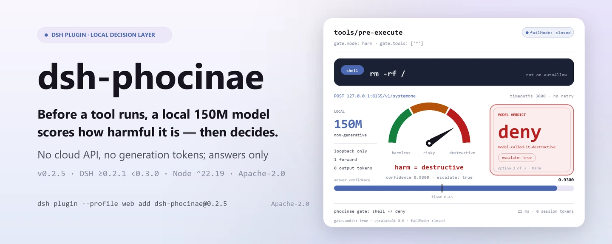
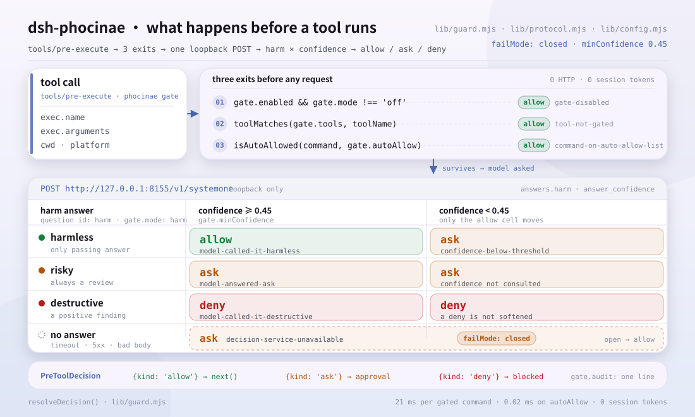
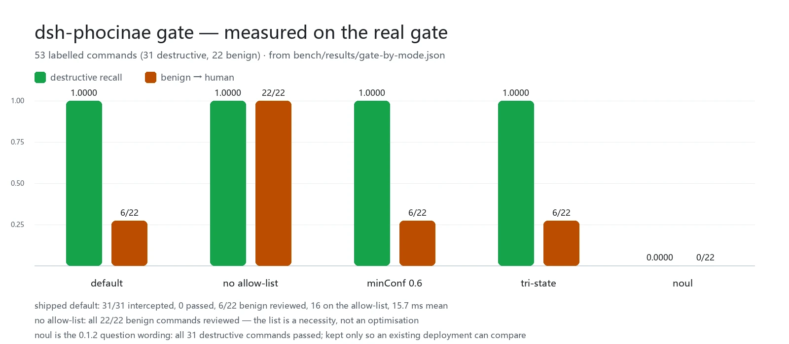

<div align="center">

<picture>
  <source media="(prefers-color-scheme: dark)" srcset="docs/assets/dsh-phocinae-hero-en-dark.webp">
  
</picture>

# dsh-phocinae

**Deixe um modelo local de 150M decidir sobre cada chamada de ferramenta antes de ela rodar — sem API na nuvem e sem tokens gerados.**

Uma camada de decisão não generativa para o DeepSeek Harness: `phocinae_ask` responde lotes de perguntas sim/não, de escolha única e de nota 2–10, enquanto `phocinae_gate` e o portão `tools/pre-execute` transformam o mesmo julgamento em `allow` / `ask` / `deny`; um serviço inacessível manda a chamada para uma pessoa em vez de liberá-la em silêncio.

[Instalação](#instalação-em-três-passos) · [Configuração](#configuração) · [FAQ](#faq) · [简体中文](README.md) · [English](README.en.md) · [Español](README.es.md) · [Português](README.pt.md) · [हिन्दी](README.hi.md)

[](LICENSE)
[](#compatibilidade)
[](https://www.npmjs.com/package/dsh-phocinae)
[](#compatibilidade)

[](https://github.com/PerryLink/dsh-phocinae/stargazers)
[](https://www.npmjs.com/package/dsh-phocinae)
[](https://dshfind.com/plugins/PerryLink/dsh-phocinae?ref=badge)
[](https://gitee.com/perrylink/dsh-phocinae)

```sh
dsh plugin --profile <name> add dsh-phocinae
```

</div>

<sub>Plugin da comunidade, sem relação com a DeepSeek. Repositório canônico: <https://github.com/PerryLink/dsh-phocinae> (o Gitee é um espelho). O modelo e o servidor são projetos separados: <https://huggingface.co/Phocinae/Phocinae-Largha-150M-v1>.</sub>

## O que é

<picture>
  <source media="(prefers-color-scheme: dark)" srcset="docs/assets/dsh-phocinae-flow-v5-dark.svg">
  
</picture>

`dsh-phocinae` tira um julgamento das mãos do modelo grande: antes de uma ferramenta rodar, o host entrega a chamada bruta a um `phocinae-server` local, onde um modelo não generativo de 150M parâmetros devolve uma resposta estruturada (sim/não, escolha única, nota 2–10) em uma passada, com confiança calibrada. O portão mapeia essa resposta para `allow` / `ask` / `deny`; ele julga, não executa, não gera e não explica.

- **Serve para**: verificações frequentes, limitáveis por limiar e repetíveis — pré-triagem de aprovação, roteamento, classificação em lote, pontuação de risco.
- **Não serve para**: escrever, resumir, traduzir, responder perguntas de conhecimento ou raciocinar sobre documentos longos; o modelo não tem essas capacidades e perguntar mesmo assim devolve uma resposta confiante e vazia.

Caminho de uma decisão: o host chama `phocinae_ask`, `phocinae_gate`, ou o portão automático dispara em `tools/pre-execute` → o plugin faz `POST` do estado bruto para `http://127.0.0.1:8155/v1/systemone` → o serviço devolve uma resposta estruturada por pergunta → o portão mapeia as respostas para `allow` / `ask` / `deny`; baixa confiança vira `escalate` e serviço inacessível vira `ask` com `failMode: closed`.

## Instalação em três passos

1. **Suba o serviço e instale o plugin.** O serviço vem primeiro: o plugin não faz inferência.

   ```sh
   # 1) serviço de decisão local (Python; o checkpoint ocupa cerca de 330 MB)
   pip install phocinae-server
   huggingface-cli download Phocinae/Phocinae-Largha-150M-v1 --local-dir ./model
   PHOC_MODEL_DIR=./model python -m phocinae.main

   # 2) o plugin (escolha um)
   dsh plugin --profile web add dsh-phocinae@0.2.5                # canal npm, versão fixada
   dsh plugin --profile web add github:PerryLink/dsh-phocinae     # canal git, main mais recente
   dsh plugin --profile web add ./dsh-phocinae-<version>.tgz      # canal tarball: após npm pack
   ```

   > Fixe `@0.2.5`: um `add dsh-phocinae` sem versão pode resolver para uma build antiga enquanto a janela `minimumReleaseAge` do pnpm segura uma release recente. Sem etapa de build: `index.mjs`, `tools.mjs` e `lib/` são os artefatos publicados.

2. **Configuração mínima** (o bundle patch já insere uma linha, então os padrões funcionam; para explicitar, assim):

   ```yaml
   - insert:
       - id: phocinae
         name: dsh-phocinae
         config:
           endpoint: http://127.0.0.1:8155/v1/systemone
           gate:
             mode: harm
             failMode: closed
   ```

3. **Confirme que está ativo**:

   ```sh
   curl http://127.0.0.1:8155/health
   dsh --profile web --dump-config | grep -A3 'id: phocinae'
   ```

   ```text
   {"status":"ok","model_loaded":true}
   ```

   `{"status":"ok","model_loaded":true}` significa que o serviço está pronto; uma linha `id: phocinae` no `--dump-config` significa que o bundle está montado. A partir daí, cada chamada filtrada passa pelo portão em `tools/pre-execute`.

**Desinstalar**: `dsh plugin --profile web remove dsh-phocinae` (ou remova a linha do profile patch).

## Capacidades principais

`dsh-phocinae` trabalha **fora da fronteira do modelo**: não gera texto, apenas converte «deve rodar, de que tipo é, quão grave é» em uma resposta estruturada e limitável por limiar.

- **`phocinae_ask`** — até 64 perguntas tipadas (`noul` / `choice` / `score`) sobre um mesmo estado, respondidas em uma passada com respostas, confiança calibrada e o sinalizador `escalate`.
- **`phocinae_gate`** — julga um comando ou ação como `allow` / `ask` / `deny`; verifica sem executar, então serve para consultar antes de agir.
- **Portão `tools/pre-execute`** — filtra toda chamada que casa com `gate.tools` antes da execução; fail-closed, serviço inacessível manda para uma pessoa.
- **Skill `phocinae`** — diz ao modelo quando uma decisão local é a ferramenta certa e como ler `escalate`, para ninguém usá-la como modelo de chat.

### Ordem de decisão

O portão percorre uma ordem fixa, e nenhum passo lê «não consegui descobrir» como «é seguro»:

```text
ferramenta fora de gate.tools        -> allow   (sem requisição)
comando em gate.autoAllow, sem operador -> allow   (sem requisição)
o modelo diz destructive             -> deny
o modelo diz risky                   -> ask
o modelo diz harmless e confiança >= limiar -> allow
o modelo diz harmless mas confiança < limiar -> ask
serviço inacessível / resposta ilegível -> ask   (failMode: closed)
```

### Superfície de comandos e ferramentas

| Superfície | Tipo | O que faz |
|---|---|---|
| `phocinae_ask` | ferramenta | Decisões estruturadas em lote; respostas, confiança e `escalate` |
| `phocinae_gate` | ferramenta | `allow` / `ask` / `deny` para um comando ou ação |
| `tools/pre-execute` | gancho | Filtragem automática antes de executar; fail-closed |
| `phocinae` | skill | Quando usar e como ler `escalate` |

### Exemplos

Estes são os pontos de entrada reais do plugin; instale uma vez e chame um.

Duas perguntas sobre um mesmo estado:

```json
{"state":"O usuário quer apagar /tmp/build. O caminho está dentro do workspace.","questions":[{"id":"safe","type":"noul","threshold":0.8},{"id":"urgency","type":"score"}]}
```

A forma da resposta é:

```json
{"answers":{"safe":true,"urgency":4},"confidence":{"safe":0.92,"urgency":0.71},"escalate":false}
```

Julgue um comando perigoso:

```json
{"command":"rm -rf /","toolName":"shell","cwd":"/home/me/project"}
```

Devolve `decision: "deny"` com motivo e confiança; o comando nunca roda. Essas saídas ilustram o schema, não são um fixture gravado.

## Dados medidos

<picture>
  <source media="(prefers-color-scheme: dark)" srcset="docs/assets/dsh-phocinae-evidence-en-dark.webp">
  
</picture>

Em 53 comandos rotulados (31 destrutivos / 22 benignos) pelo portão real (`lib/guard.mjs`): **o padrão de fábrica interceptou os 31 comandos destrutivos, 0 passaram**; apenas 6/22 comandos benignos foram para uma pessoa, 16 usaram a lista de auto-permissão sem sair do processo, e a média foi 15.7 ms. O recall em nível de pergunta é outro número: `harm` 0.97, `tri-state` 0.74, `noul` 0.00 — esses três números são toda a razão de `harm` ser o padrão.

Latência e custo: uma decisão local (ida e volta HTTP, tokenize + passada + montagem da resposta) leva 42.6 ms; filtrar um comando leva 21 ms; um comando da lista leva 0.02 ms. O portão é um gancho de `tools/pre-execute`, não uma mensagem, então **não consome tokens de sessão**; as duas definições de ferramenta somam 685 tokens fixos por requisição, cerca de 234 tokens por decisão depois de amortizados.

O compromisso híbrido (conjunto typed oficial, 400 casos / 2000 decisões): com τ=0.40 escala 6.8% dos casos, economiza 93.3% dos tokens e obtém 0.7305 (só local 0.7320, só modelo grande 0.7085); subir τ para 0.60 economiza apenas 9.2% e obtém 0.7115, abaixo de só local.

Esses números são um retrato pontual de `dsh-phocinae@0.2.1` em 2026-10-08; os critérios e a procedência linha a linha estão em [`bench/REPORT-0.2.1-measurements.md`](bench/REPORT-0.2.1-measurements.md), os resultados brutos em `bench/results/*.json`, e dá para regenerar com `node bench/gate-bench.mjs` e `node bench/token-savings.mjs`.

## Configuração

Os padrões ficam em `cordis.patch.yml` e `lib/config.mjs`, e toda chave tem um; valor ilegal lança erro **no carregamento**, então uma configuração ruim nunca chega ao portão em execução. Uma sobrescrita por id substitui a linha inteira: repita todas as chaves que precisar.

Chaves mais usadas:

| Chave | Padrão | Significado |
|---|---|---|
| `endpoint` | `http://127.0.0.1:8155/v1/systemone` | Serviço de decisão; somente loopback, salvo `allowRemoteEndpoint: true` |
| `timeoutMs` | `3000` | Tempo por requisição; uma tentativa |
| `escalateAt` | `0.6` | Confiança abaixo disso marca `escalate: true` (um sinal, não uma promessa de economia de tokens) |
| `gate.mode` | `harm` | `harm` / `tri-state` / `noul` / `off` |
| `gate.tools` | `['*']` | Ferramentas a filtrar: nome exato, glob ou `*` |
| `gate.failMode` | `closed` | `closed` manda para uma pessoa se o serviço cair; `open` libera |
| `gate.autoAllow` | cerca de 95 verbos de leitura/build (o bundle patch embute 14 deles) | Prefixos de comando liberados sem consultar o modelo; entrada com operador de shell é recusada no carregamento |

<details>
<summary>Tabela completa de configuração (17 chaves)</summary>

| Chave | Padrão | Significado |
|---|---|---|
| `endpoint` | `http://127.0.0.1:8155/v1/systemone` | Serviço de decisão; somente loopback, salvo `allowRemoteEndpoint: true` |
| `model` | `Phocinae-Largha-150M-v1` | Nome do modelo na requisição; o servidor responde 422 para qualquer outro |
| `timeoutMs` | `3000` | Tempo por requisição; uma tentativa |
| `escalateAt` | `0.6` | Confiança abaixo disso marca `escalate: true` (um sinal, não uma promessa de economia de tokens) |
| `maxStateChars` | `4096` | Limite de caracteres do estado renderizado; o excedente é truncado no fim e marcado |
| `permuteChoice` | `false` | Pede ao servidor para fazer média por permutação nas perguntas `choice` (4× passadas) |
| `allowRemoteEndpoint` | `false` | Permite explicitamente um `endpoint` não loopback; desligado porque o estado carrega texto bruto de comandos |
| `gate.enabled` | `true` | Interruptor geral do portão de aprovação |
| `gate.mode` | `harm` | `harm` / `tri-state` / `noul` / `off` |
| `gate.threshold` | `0.8` | Apenas modo `noul`: P(risky) a partir disso conta como sinal positivo |
| `gate.escalateAt` | `0.6` | Limiar próprio de revisão do portão (separado do `escalateAt` das ferramentas) |
| `gate.tools` | `['*']` | Ferramentas a filtrar: nome exato, glob ou `*` |
| `gate.failMode` | `closed` | `closed` manda para uma pessoa se o serviço cair; `open` libera |
| `gate.riskyDecision` | `deny` | Se um veredito `risky` com confiança vira `deny` ou `ask` |
| `gate.minConfidence` | `0.45` | Confiança que um `allow` precisa; abaixo disso a chamada vai para uma pessoa (a confiança do modelo é comprimida, daí o limiar baixo) |
| `gate.autoAllow` | cerca de 95 verbos de leitura/build (o bundle patch embute 14 deles) | Prefixos de comando liberados sem consultar o modelo; entrada com operador de shell é recusada no carregamento |
| `gate.audit` | `true` | Uma linha de log do host por veredito (ferramenta, veredito, motivo, confiança) |

</details>

Para usar só as ferramentas e não filtrar nada:

```yaml
- id: phocinae
  config:
    gate:
      mode: off
```

## FAQ

<details>
<summary>O que acontece se o serviço de decisão cair? Ele falha em silêncio liberando?</summary>

Nada é silencioso. Com `failMode: closed` o portão transforma a chamada filtrada em `ask` (motivo `decision-service-unavailable`), e a ferramenta informa `PHOCINAE_SERVICE_UNAVAILABLE` indicando o comando que sobe o serviço. Um `deny` é um achado positivo e nenhuma confiança baixa o suaviza até liberar; resposta não 2xx, corpo que não é JSON, resposta fora da faixa ou ausência da extensão `answer_confidence` são tratados como inacessível ou marcados `escalate: true`, e também nunca são liberados automaticamente.

</details>

<details>
<summary>Para onde vai o texto dos meus comandos?</summary>

Só para o `endpoint`, que por padrão é `127.0.0.1:8155`; endereço não loopback é erro de carregamento, salvo se você ativar `allowRemoteEndpoint: true` de propósito. O plugin não escreve domínio de armazenamento, não envia telemetria e não lê credenciais. Com `gate.audit` ligado, cada veredito registra uma linha: ferramenta + veredito + motivo + confiança, nunca o texto do comando.

</details>

<details>
<summary>Ele briga com outros plugins por eventos ou nomes de ferramenta?</summary>

Não. Ele assina apenas `tools/pre-execute` e chama `next()` exatamente uma vez no caminho de permissão; as ferramentas são `phocinae_ask` e `phocinae_gate`, ele não oferece chave de serviço, não registra prefixo `webServer` e não traz metade de cliente. O argumento ponto a ponto está em «Interoperabilidade com outros plugins de DSH».

</details>

<details>
<summary>Quanto custa em desempenho?</summary>

Em CPU local uma decisão leva 42.6 ms (ida e volta HTTP), filtrar um comando leva 21 ms em média e um comando da lista leva 0.02 ms sem sair do processo; o portão é um gancho, então 0 tokens de sessão, e o custo constante são 685 tokens por requisição pelas duas definições de ferramenta. A precisão está em «Dados medidos».

</details>

<details>
<summary>Por que não deixar um modelo grande julgar cada comando?</summary>

Dá para ligar `escalate` a um modelo grande, mas faça as contas primeiro: o modelo local de 150M é melhor em `choice` (0.7529 contra 0.6793) e o grande só ganha em `noul` (0.7767 contra 0.6833); escalar um caso inteiro de respostas incertas também reescreve as respostas `choice` que já estavam certas. Por isso τ deve ser baixo (0.30–0.40), e não o 0.6 do cartão do modelo.

</details>

## Solução de problemas

| Sintoma | Correção |
|---|---|
| `PHOCINAE_SERVICE_UNAVAILABLE` | Suba o serviço e confira `curl http://127.0.0.1:8155/health` |
| Add sem versão instala versão antiga | Reinstale com `dsh-phocinae@0.2.5`; confirme a versão em `dsh --profile web --dump-config` |
| O portão pergunta por tudo | Confirme que o serviço está no ar; com `failMode: closed` um serviço caído pergunta de propósito: é o desenho, não um defeito |
| O portão é rígido ou frouxo demais | Ajuste `gate.mode`, `gate.tools`, `gate.minConfidence`, `gate.autoAllow`; se todo comando precisa passar por uma pessoa, ponha `gate.autoAllow` em `[]`, ao custo de revisar também os benignos |

## Limites de segurança

- **Somente loopback.** O estado carrega texto bruto da chamada; `endpoint` não loopback é erro de carregamento, salvo se `allowRemoteEndpoint: true` for ativado de propósito.
- **Fail-closed.** Erros e timeouts do serviço mandam a chamada filtrada para uma pessoa; resposta ausente ou ilegível faz o mesmo; `deny` nunca é suavizado por baixa confiança.
- **Configuração ruim falha no carregamento.** `gate.mode` desconhecido, número fora da faixa, entrada de `gate.autoAllow` com operador de shell e endpoint não loopback lançam erro na ativação, nunca no portão em execução.
- **Não é sandbox.** O portão é um sinal extra de aprovação, não substitui o sandbox do host nem a aprovação humana; pelo contrato documentado, um `ask` vira negação em um deployment sem serviço de aprovação, nunca permissão silenciosa.
- **Não gera.** O modelo não responde perguntas de conhecimento, não escreve código nem resume; só produz julgamentos estruturados.
- **Registros são efeitos.** Ferramentas, skill e assinatura de evento somem com o ciclo de vida do plugin, então um hot reload não deixa ouvintes soltos.

## Permissões e dados

- **Capacidades**: `dsh.capabilities` declara `network:egress` (só para o serviço de decisão local) e `tools:register`.
- **Credenciais**: sem API key, nenhum segredo do ambiente é lido; os pesos são baixados por você na sua máquina.
- **Dados**: sem domínio de armazenamento, sem telemetria; o único dado de saída é o texto do estado, e o destino é o processo local indicado por `endpoint`.

## Limitações conhecidas

- **Não gera.** Não escreve, resume, traduz, responde perguntas de conhecimento nem raciocina sobre documentos longos; perguntar mesmo assim devolve uma resposta confiante e vazia.
- **A confiança é comprimida.** No conjunto de 53 comandos a confiança de `allow` no `tri-state` fica em 0.27–0.54; em 2000 decisões typed a mediana é 0.629. Por isso a lista de auto-permissão é necessidade, não otimização: tire-a e os 22 comandos benignos vão para uma pessoa.
- **O recall de `noul` é 0.00.** Ele é mantido só para que um deployment existente compare o antigo com o novo no próprio tráfego; não é o padrão e deployments novos não deveriam usá-lo.
- **O «economiza 82% com τ=0.6» do cartão do modelo não se aplica.** Esse 82% pertence a τ≈0.50, onde a precisão já caiu para 0.7065; nesta carga τ=0.60 economiza apenas 9.2% e pontua abaixo de só local.
- **Precisa de um segundo processo Python.** O plugin não faz inferência: `phocinae-server` e um checkpoint de ~330 MB precisam estar rodando localmente, com `/health` acessível.
- **64 perguntas por chamada e 4096 caracteres de estado**; o excedente é truncado e marcado `[truncated]`, preservando a cabeça do comando.
- **Sem metade de navegador.** O pacote não registra slot de cliente; a interação de `ask` / `deny` fica com a superfície de aprovação do host.

## Interoperabilidade com outros plugins de DSH

Verificado contra o corredor de DSH para o qual este README é publicado (`>=0.2.1-0 <0.3.0`) e contra a composição real de `test/integration/boot-headless.mjs`.

Este plugin **não interfere** em outros plugins:

- **Sem colisão de nome de ferramenta.** Registra apenas `phocinae_ask` e `phocinae_gate`, ambas com namespace.
- **Sem colisão de chave de serviço.** Não oferece chave de serviço alguma, então não pode colidir em uma.
- **Sem colisão de slot.** Não registra chave de slot de cliente e nunca disputa uma vaga de UI.
- **Sem colisão de rota HTTP.** Não registra prefixo `webServer`.
- **Sem colisão de camada de patch.** O bundle patch só faz `insert` da própria linha; nunca sobrescreve o `config` de uma linha embutida.
- **Sem mutação global.** Não altera protótipos, não reescreve `process.env` nem substitui o dispatcher global de fetch.

**Eventos compartilhados não interferem.** Ele escuta o evento sensível à ordem `tools/pre-execute` com a semântica de broadcast do Cordis, em que todo ouvinte roda. **O ouvinte daqui chama `next()` exatamente uma vez, no caminho de permissão**; `ask` / `deny` devolvem um `PreToolDecision` em vez de chamar `next(err)` (que rejeitaria a cascata), então não curto-circuita os outros nem deixa uma queda do serviço derrubar a cadeia.

## Compatibilidade

| Superfície | Estado |
|---|---|
| Harness | DSH `>=0.2.1-0 <0.3.0`: a linha do bundle monta `phocinae_ask`, `phocinae_gate`, o portão `tools/pre-execute` e a skill `phocinae` |
| Node | `^22.19.0 \|\| >=24.0.0` |
| Plataformas | Onde o DSH rodar; `gate.tools` cobre `pwsh` e `bash` por padrão, e a lista de auto-permissão inclui verbos de leitura de PowerShell e POSIX |
| Serviço de decisão | `phocinae-server` acessível em `127.0.0.1:8155`, com `/health` devolvendo `{"status":"ok","model_loaded":true}` |

## Ecossistema e qualidade

- [Espelho no Gitee](https://gitee.com/perrylink/dsh-phocinae) (sincronizado por [.github/workflows/gitee-sync.yml](.github/workflows/gitee-sync.yml); o GitHub é a referência)
- [Página no dshfind](https://dshfind.com/plugins/PerryLink/dsh-phocinae) (instalações e ranking)
- [Base de conhecimento do ecossistema](https://perrylink.github.io/dsh-plugin-guide/): guia de desenvolvimento · dados de seleção · critérios de manutenção

## Desenvolvimento

```sh
npm test                          # node --test: config / protocol / guard / contrato / regressões
npm run test:integration          # portão HTTP real + composição real do dsh
npm run bench:gate                # benchmark do portão em 53 comandos rotulados
npm run bench:formulations        # comparação de formulações e separação
npm run verify:artifacts          # arquivos publicados presentes + index.mjs importável
npm run check:readmes             # consistência dos README em cinco idiomas
npm pack                          # o tarball publicado
```

Sem etapa de build: ESM puro, `index.mjs`, `tools.mjs` e `lib/` são os artefatos publicados. Os testes têm cinco camadas (`lib` / `contract` / `regressions` / integração HTTP real / composição real do `dsh`); o serviço de decisão falso é uma simplificação deliberada: o que se afirma é o roteamento do veredito, não que o modelo seja esperto.

| Arquivo | Responsabilidade |
|---|---|
| `index.mjs` | Ativação: resolução de config, registro via `ctx.inject(['tools'])`, assinatura de `tools/pre-execute`, registro da skill |
| `tools.mjs` | As duas `ToolDefinition` (`phocinae_ask`, `phocinae_gate`), schemas escritos à mão, sem dependência em execução |
| `lib/config.mjs` | Resolução e validação de config, casamento de ferramentas e comandos |
| `lib/protocol.mjs` | Cliente de `/v1/systemone`, coerção de respostas, formas de prompt |
| `lib/guard.mjs` | Regras de veredito e o ouvinte de `tools/pre-execute` |
| `lib/constants.mjs` | Vocabulário e padrões (zero dependências) |
| `lib/errors.mjs` | Códigos de erro estruturados |
| `skills/phocinae/SKILL.md` | Texto da skill: quando usar, como ler `escalate` |

As imagens do README são geradas por [`scripts/gen-readme-assets.py`](scripts/gen-readme-assets.py) (Python + Pillow; aborta se não achar fonte CJK): `python scripts/gen-readme-assets.py` pode ser reexecutado e grava `docs/assets/dsh-phocinae-hero-{zh,en}-{light,dark}.webp` e `docs/assets/dsh-phocinae-flow-v5-{light,dark}.svg`; `--evidence` também redesenha `docs/assets/dsh-phocinae-evidence-{zh,en}-{light,dark}.webp`.

Topics: `dsh`, `dsh-plugin`, `deepseek-harness`, `deepseek`, `cordis`, `phocinae`, `decision-model`, `approval-gate`, `pre-tool-use`, `escalation`, `tool-routing`, `local-inference`, `cordis-plugin`

## Família e agradecimentos

Este projeto faz parte da família de plugins de DeepSeek Harness do [PerryLink](https://github.com/PerryLink) (todos Apache-2.0). Se for útil, **uma estrela ajuda a próxima pessoa a encontrá-lo**; não desbloqueia nada.

- [@PerryLink](https://github.com/PerryLink) — criador e mantenedor: o encapsulamento do plugin sobre a camada de decisão local, o portão fail-closed e seu critério de escala `harm`, a regra de operadores da lista de auto-permissão e a documentação em cinco idiomas.
- O modelo de decisão e o servidor são mantidos separadamente pela [Phocinae](https://huggingface.co/Phocinae): [Phocinae-Largha-150M-v1](https://huggingface.co/Phocinae/Phocinae-Largha-150M-v1) e [phocinae-server](https://github.com/Phocinae/phocinae-server).

## Licença

[LICENSE](LICENSE) (Apache License 2.0) © 2026 dsh-phocinae contributors

<p align="center"><sub>Apache-2.0 · Plugin da comunidade, sem relação com a DeepSeek.</sub></p>
